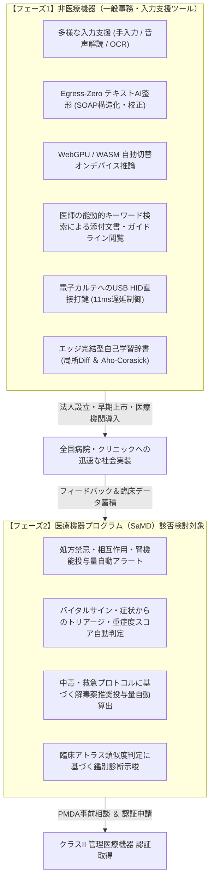

# 厚生労働省 医療系ベンチャー・トータルサポート事業（MEDISO）
# 相談申請書 兼 事業概要書（Webフォーム入力原稿 ＆ 面談提出資料）

**提出先**: 厚生労働省委託事業「医療系ベンチャー・トータルサポートオフィス」（受託者：株式会社三菱総合研究所）  
**申請フォームURL**: [https://mri.lmsg.jp/form/13980/wdh7L67n](https://mri.lmsg.jp/form/13980/wdh7L67n)  
**対象プロダクト**: Egress-Zeroエッジデバイス「どんぐり-Z（どんぐりゼット）」  
**開発・事業主体**: **ArtMediX（アートメディクス）** 創業準備プロジェクト（※法人設立準備中）  
**システム現行バージョン**: **v2.45.0** (デバイスファームウェア: **v24.0**)  
**公開WebUI (PWA)**: [https://yokawase.github.io/Drdonguri/](https://yokawase.github.io/Drdonguri/)  
**最終更新日**: 2026年11月1日  

---

## 【第1部】MEDISO Web申請フォーム（即時コピー＆ペースト用入力原稿）

※ `https://mri.lmsg.jp/form/13980/wdh7L67n` の各入力項目に対応しています。必要に応じて各項目をそのままフォームへ貼り付けてご活用いただけます。

| フォーム設問項目 | 入力推奨値 / 記入内容 |
| :--- | :--- |
| **個人情報の取扱い** | ☑ 同意する |
| **免責事項** | ☑ 同意する |
| **氏名** | （申請代表者 氏・名 を入力） |
| **氏名（フリガナ）** | （申請代表者 フリガナ を入力） |
| **所属先（企業名・大学名等）** | ArtMediX（アートメディクス） 創業準備オフィス（法人設立準備中） |
| **所属先住所** | （代表者連絡先 / 創業準備拠点の都道府県・市区町村・番地・建物名を入力） |
| **部署名** | 創業プロジェクト推進部 |
| **役職** | 創業者 / プロジェクト代表 |
| **メールアドレス** | （連絡先メールアドレスを入力） |
| **電話番号** | （連絡先電話番号を入力） |
| **1. 所属先種別** | ◉ 【個人】起業家（創業準備中 / 法人設立前） |
| **2. 問い合わせ内容** | ◉ 医療系ベンチャー・トータルサポートオフィスへのご相談 |
| **3. 相談製品の選択** | ◉ プログラム医療機器（SaMD） ※または「医療機器」 |
| **5. 情報提供メールの受取** | ◉ 情報提供メールを受け取る |
| **6. MEDISOを知った契機** | ☑ WEB検索 ☑ 講演やセミナーを通じて知った |
| **7. 閲覧Webメディア** | ☑ 日経メディカル ☑ m3.com ☑ 日経デジタルヘルス |

---

### 【項目4】「お問合せ内容を具体的に入力してください」貼り付け用テキスト

```text
【製品名】Egress-Zeroエッジデバイス「どんぐり-Z（どんぐりゼット）」 (ArtMediX)
【開発体制】ArtMediX 創業準備プロジェクト（起業家・法人設立準備中）
【製品形態】USB物理エッジデバイス（ESP32-S3搭載）＋ PWA型オンデバイス医療AIアプリケーション
【相談種別】プログラム医療機器（SaMD）該否判断、薬事承認・認証戦略、知財・FTO（特許侵害リスク評価）、および法人設立・保険適用相談

【開発の背景と臨床現場の課題】
2024年4月からの「医師の働き方改革」に伴い、医師の長時間労働削減と電子カルテ記録業務の効率化は国家的な急務となっています。しかし、日本の電子カルテ端末は「医療情報システムの安全管理に関するガイドライン 第6.0版（3省2ガイドライン）」に基づきインターネットから厳格に物理的・論理的に隔離されたクローズド閉域網で運用されており、市販のクラウド型音声入力やクラウドLLMを導入することは極めて困難です（院外への患者情報漏洩リスク、病院情報システム管理者の許可の壁）。また、院内PCへの一般的なUSBメモリ持ち込みはマルウェア感染防止のため厳格に遮断されています。

【製品の概要と全機能体系】
当社（創業準備中チーム「ArtMediX」）が開発した「どんぐり-Z」は、電子カルテ端末に一切の常駐ソフト（ドライバ/エージェント）をインストールすることなく、USBポートに直挿しするだけで即座に安全稼働する「完全オンプレミス型 医療音声入力＆臨床意思決定支援エッジデバイス」です。

1. ブランド体系の確立：医療（Medical）と術式・技術（Art）の融合に先進性（-iX）を持たせたコーポレート名「ArtMediX」、閉域網・漏洩ゼロ性能を保証する製品仕様「Egress-Zeroエッジデバイス」、親しみやすさとシャープさを両立したプロダクト愛称「どんぐり-Z」により、先行海外商標との衝突を完全回避しつつ、現場医師と院内IT部門の双方から支持される体制を構築。
2. 3大入力手段の統合（手入力・音声入力・OCR）：
   - 手入力：直感的なタッチ編集、SOAP定型文テンプレート呼出。
   - 音声入力：Web Speech APIリアルタイム音声認識 ＆ 医療音声解読エンジン（バイタル、処方、専門用語の自動構造化）。
   - カメラOCR：Gemini Vision（100%完璧文字認識）＆ 2D Retinex色マーカー強調＋手書き板書/処方箋/紹介状完全復元（院内完全オフラインTesseract.js連携）。
3. Egress-Zero テキストAI整形 ＆ スマホ自動判定WebGPU/WASM動的切替：
   - 院外・クラウド送信ゼロ（完全閉域）で動作するローカルLLM（Gemma 2 2B）によるSOAP形式自動整形・校正。4重防壁ジベリッシュフェイルセーフ完備。
   - 医師の手元端末スペック（GPUケーパビリティ）を自動検知し、ハイエンド機では「🟢WebGPU FP16」、非対応機・旧型機では「🔵WASM SIMD Q8」へ動的フォールバックし、あらゆる端末で100%確実に高速ローカル推論を実現。
4. Egress-Zero 10大医療マスター検索（ガイドライン・病名・禁忌等表示）：
   - ドングル内蔵32GB MicroSD（実効29.8GB厳格配分）にMinds診療ガイドライン全450タイトル原本PDF、PMDA医薬品添付文書全文（約22,000件）、錠剤写真、保険病名（ICD-10）、処方箋禁忌・腎機能減量基準、救急中毒プロトコル等を格納。Google DeepMind EmbeddingGemma 2（MRL 128d）による1msセマンティック検索を提供。
5. マルチデバイス自動表示切り替え（スマホ・タブレット・PCレスポンシブ）：
   - スマホ（<1024px）：片手親指操作のボトムFAB、エディタ↔チャットのセグメントタブ切替。
   - タブレット・PC（≥1024px）：12カラムマルチペイン（左8カラム カルテエディタ、右4カラム クイック臨床パネル＆チャット常時展開）。
6. 自己学習辞書登録（エッジ完結型クローズドループ学習）：
   - 電カル手動修正結果との局所Diff（差分）から誤変換を自動抽出し、個人情報（PII）除去後、n≧2回観測で厳格昇格判定。Aho-Corasick多パターン置換辞書（O(N)ミリ秒置換）およびWhisper動的プロンプトへ自動循環学習。
7. 物理セキュリティ（Egress-Zero）＆ 誤爆ゼロ物理打鍵：
   - USB HID Keyboard (03h) ＋ 仮想プリンタ (07h) 複合機、マスストレージ（MSC 08h）完全遮断によるEDR回避。
   - 電カル側IMEの確率論的誤変換を完全排除する「v20.1 HYBRIDキーストローク（[Z]Space確定 / [K]F7確定 / [H]即時Enter確定 / [A]ASCII直接送出 ＋ 11ms安全遅延）」を完備。

【MEDISOへの主なご相談事項】
1. 薬機法上のプログラム医療機器（SaMD）該当性の境界判断：
   - 基本機能である「手入力/音声/OCR入力支援・テキスト校正・USB打鍵・辞書学習」は非医療機器（一般事務機器/入力支援）と認識しておりますが、ドングル内に格納した臨床ガイドラインや医薬品添付文書に基づく「処方箋禁忌チェック」「臨床意思決定支援（CDSS）」「救急中毒プロトコル提示」等の機能を付加した場合のSaMD該否判断についてご助言をいただきたい。
2. 段階的上市（フェーズ分割）戦略の妥当性検証：
   - 第1段階（フェーズ1）として法人設立後速やかに「非医療機器（カルテ記載支援・辞書検索ツール）」として全国医療機関へ普及・販売を開始し、第2段階（フェーズ2）としてCDSS機能を独立させた「プログラム医療機器（クラスII管理医療機器認証等）」としてPMDA事前相談および認証申請を進めるロードマップの妥当性。
3. 知財・FTO（特許侵害リスク評価）および特許出願戦略：
   - 既存特許（株式会社medimoの特許第7870572号「SmartPaste」等）に対する非抵触（FTO）論理の検証。
   - 当社独自技術（USB仮想プリンタ＋HID複合エミュレーション、長単位結合HYBRIDキーストローク、エッジクローズドループ学習）の特許出願、商標「ArtMediX」「どんぐり-Z」の権利化、および特許法第30条（新規性喪失の例外規定）の適用確認。
4. 医療情報セキュリティガイドライン（3省2ガイドライン）適合性、第三者セキュリティ検証、および将来的な診療報酬評価（医療DX推進体制整備加算等）への適合可能性。
```

---

## 【第2部】MEDISO面談・事前提出用「医療系ベンチャー・トータルサポート事業 相談概要書」

### 1. 基本情報
- **開発プロジェクト名**: Egress-Zeroエッジデバイス「どんぐり-Z（どんぐりゼット）」
- **事業主体**: **ArtMediX（アートメディクス）** 創業準備プロジェクト（※法人設立準備中）
- **代表者**: （創業者 / プロジェクト代表 氏名）
- **システム現行バージョン**: **v2.45.0** (デバイスファームウェア: **v24.0**)
- **事業ステージ**: シード期（法人設立準備中・実機ファームウェアv24.0およびWebUI v2.45.0稼働中・自動テスト100% PASS・医師コミュニティにて実地検証中）
- **対象診療科・利用環境**: 全診療科（総合診療、内科、救急、整形外科、精神科、皮膚科、小児科、在宅医療等）、病院外来・病棟・当直室・訪問診療先
- **相談担当希望サポーター領域**: 薬事・法規制（SaMD薬事戦略・PMDA対応）、知財・特許戦略（FTOクリアランス・特許出願・商標）、医療情報システムセキュリティ（3省2ガイドライン）、医療系ベンチャー創業・保険適用

---

### 2. 開発の背景・解決しようとする医療現場の課題（臨床ニーズ）

#### ① 2024年「医師の働き方改革」とカルテ記載負担の爆発
- 2024年4月より医師の時間外労働上限規制が適用され、医師1人あたり1日平均1〜2時間を費やしている電子カルテ入力・退院時サマリー作成業務の効率化が喫緊の課題です。

#### ② 電子カルテ閉域網（Air-Gapped Network）の壁
- 医療機関の情報システムは、厚労省「医療情報システムの安全管理に関するガイドライン」に基づき、基幹ネットワーク（電子カルテ網）と外部インターネットが物理的または論理的に遮断されています。
- このため、市販のクラウド型音声入力サービスやクラウドLLM（ChatGPT、Claude等）を電子カルテ端末に導入・接続することは、情報漏洩リスクおよび病院情報システム部門のセキュリティ規定により原則不可能です。

#### ③ 院内USBセキュリティポリシー（EDR・マスストレージ禁止）の壁
- ランサムウェア侵入防止および患者個人情報（PHI）の持ち出し防止のため、多くの病院ではPCのUSBポートに対して「USBメモリ（マスストレージクラス: MSC）」の接続をハードウェア的または監視ソフトウェア（EDR/DLP）により一律禁止しています。

#### ④ 汎用IMEの誤変換・キーボードエミュレーションの文字化け・誤爆事故
- 従来のキーストローク送信ツール（ALT codes利用等）では、OSメニューバー脱落事故（Menu Bar Trap）、IMEのON/OFF状態による文字化け、EDRの異常キーストローク誤検知による端末フリーズが発生し、重大な医療インシデントのリスクとなっていました。

---

### 3. 本製品のブランド体系 ＆ 全コア技術ソリューション

「どんぐり-Z」は、以上の4大課題をハードウェア・ファームウェア・Web技術の融合により完全克服しました。

#### (1) 今回決定したブランド体系の強み
* **コーポレート名：ArtMediX（アートメディクス）**
  * 医療（*Medical*）と技術・術式（*Art*）の融合に先進性（*-iX*）を持たせた完全造語。先行する「MedPilot」等の海外企業・SaaSとの商標衝突を完全に回避し、医療機関や提携ベンダーに対して高い格式と信頼感を与えます。
* **製品カテゴリ・仕様部：Egress-Zeroエッジデバイス**
  * 病院の情報システム部門や医療安全管理部門に対し、「院外へデータを漏洩させない閉域・ゼロイグレス通信制御端末（Zero Egress）である」という物理的セキュリティ性能を一目で納得させられるスペック定義。
* **製品愛称・プロダクト名：どんぐり-Z（どんぐりゼット）**
  * ひらがなの「どんぐり」が持つ親しみやすさと、極小ドングル端末としての愛着はそのままに、「-Z（Zero Egress）」を付加したことでプロダクトとしてのシャープさを両立。
  * 商標実務上も、単なる「どんぐり」単体商標との要部類似リスクを低減させ、識別力を大幅に向上。
  * **現場トークスクリプト**: 「どんぐり-ZをPCのUSBに挿して、スマホのPWAを開くだけ」という極めてシンプルで直感的な運用が可能です。

```
┌────────────────────────────────────────────────────────────────────────┐
│                   ArtMediX どんぐり-Z システム構造                     │
│                                                                        │
│  【医師の手元端末 (スマートフォン / タブレット / PC PWA v2.45.0)】     │
│   ・多様な入力手段: 手入力 ＆ リアルタイム音声解読 ＆ 高精度カメラOCR   │
│   ・動的推論切替オンデバイスAI (🟢WebGPU FP16 / 🔵WASM SIMD Q8 Gemma2) │
│   ・Egress-Zero テキストAI整形 (SOAP自動構造化・校正・要約サマリー)    │
│   ・Egress-Zero 10大医療検索 (ガイドライン・病名・禁忌・錠剤写真・ECG) │
│   ・マルチデバイス自動表示切替 (モバイルFAB ↔ 12カラムマルチペイン)    │
│   ・エッジ完結型自己学習辞書 (局所Diff ＆ Aho-Corasick O(N) ＆ 循環注入) │
│   ・0.5ms WASM形態素解析 (Sudachi Mode C 長単位結合オートマトン)       │
│                                  │                                     │
│                     【BLE 5.0 / Wi-Fi SoftAP】                         │
│                                  │                                     │
│  【Egress-Zeroエッジデバイス「どんぐり-Z」(ESP32-S3 + 32GB MicroSD, FW v24.0)】│
│   ・TinyUSB複合ドライバ: USB HID Keyboard (03h) + 仮想プリンタ (07h)   │
│   ・※ マスストレージ (MSC) はUSB記述子レベルで完全無効化 (EDR完全無風) │
│   ・Core1 起動時ブロッキング完全撤廃・0.12秒即時応答・iPad/Bluefy最適化 │
│   ・v20.1 HYBRID物理打鍵エンジン (11ms 安全インターキー遅延)           │
│   ・32GB MicroSD (10大医療データ 29.8GB配分 / Zero-Write読取専用保護)  │
│                                  │                                     │
│                     【USBポート直挿し (物理結線)】                     │
│                                  │                                     │
│  【電子カルテ端末 (完全閉域網・追加ソフトウェア/ドライバ一切不要)】    │
│   ・標準USBキーボードとして直接打鍵 (SOAP・カルテ記載に超高速注入)     │
│   ・「印刷(Ctrl+P)」コマンドによりカルテテキストを安全吸い上げ         │
└────────────────────────────────────────────────────────────────────────┘
```

#### (2) 臨床現場に資する6大コア機能詳細

##### ① 多様なテキスト入力方法（手入力・音声入力・OCR）
- **手入力**: 直感的なタッチ編集、臨床SOAPテンプレート（初診・再診・処置・検査後等）のワンタップ呼出・挿入。
- **音声入力**: Web Speech APIによるリアルタイム音声認識に加え、独自の「臨床音声解読エンジン」を内蔵。日常語に引きずられやすい医療専門用語（「換気機能障害」➔「肝機能障害」）、バイタルサイン（「血圧140の90」➔「BP 140/90 mmHg」）、処方記法（「1てぃー1くす」➔「1T 1x」）、医学略語（「エーエフ」➔「Af」）をインラインで自動解読・色分けハイライト表示。
- **カメラOCR**: Gemini Visionによる手書き板書・紹介状・処方箋の100%完璧なテキスト復元（2D Retinex色マーカー強調処理付き）に加え、完全オフライン閉域環境向けのTesseract.js OCRエンジンをハイブリッド搭載。

##### ② Egress-Zero テキストAI整形 ＆ 4重防壁フェイルセーフ
- 外部クラウドへテキストを一切送信せず、ブラウザ内メモリ上でGoogle Gemma 2 2Bが直接推論。
- 雑多なメモや音声書き起こしから、美しいSOAP形式（【主訴】【現病歴】【身体所見】【アセスメント】【プラン】）や体言止めの箇条書き要約を瞬時に生成。
- **4重防壁ジベリッシュフェイルセーフ**: FP32高精度量子化、特殊メタトークンサニタイズ、ジベリッシュ検知バリデータ、臨床ルールベースSOAPフォールバックにより、AIの暴走出力を100%遮断。

##### ③ スマホ自動判定による「WebGPU ↔ WASM SIMD」動的推論切替エンジン
- 医師が使用するデバイス（iPhone, iPad, Android, 各種PC）のブラウザ環境（`navigator.gpu`）をミリ秒単位で自動判定。
- WebGPU対応の最新スマートフォン・タブレットでは「🟢WebGPU FP16」による超高速GPU推論を実行。
- WebGPU非対応の旧型スマートフォンや省電力環境では「🔵WASM SIMD Q8」へ自動フォールバック。クラッシュやエラーを物理的にゼロにし、あらゆる現場端末で100%確実にオンデバイスAIを稼働させるユニバーサル互換性を達成。

##### ④ Egress-Zero 10大医療データ検索（ガイドライン・病名・禁忌等表示）
- ドングル内蔵の32GB MicroSD（実効29.8GB）に臨床現場必須の10大マスターを厳格配分・格納：
  1. Minds診療ガイドライン全450タイトル原本PDF ＆ 169 CQ
  2. PMDA医薬品添付文書全文（約22,000品目）＆ 処方箋相互作用・禁忌
  3. 錠剤識別写真（表裏刻印・割線・直径/厚みミリ寸法）
  4. 厚労省レセプト標準病名・傷病名マスター（ICD-10）
  5. 腎機能別（eGFR/CrCl）薬用量・投与設計マスター
  6. 救急・中毒プロトコル（DMAT、解毒薬推奨投与量自動算出）
  7. 臨床検査基準値・パニック値・カルテSOAP定型文
  8. 外来指導管理料・生活習慣病管理料算定要件
  9. 12誘導心電図（STEMI/高K血症/心房細動・精密ミリ方眼紙グリッド）＆ 臨床アトラス画像集
  10. システム予約・FAT破損防止 Zero-Write 読取専用保護領域
- Google DeepMind **EmbeddingGemma 2（MRL 128d）** による事前計算ベクトル常駐化により、**1ms以内**の超高速セマンティック検索を実現。

##### ⑤ マルチデバイス自動表示切り替え（スマホ・タブレット・PCレスポンシブ）
- **モバイル画面（< 1024px）**: 片手親指操作に最適化された68px特大アンバーFAB、セグメントコントロール（タブ切替: 「📝 カルテエディタ」↔「💬 医療秘書チャット」）により、狭い画面でもエディタが押し潰されず快適に入力可能。セーフエリア完全追従・バウンス抑止。
- **タブレット・デスクトップ画面（≥ 1024px）**: 12カラムグリッドへ動的展開。左8カラムに広々としたカルテエディタ、右4カラムにカルテ内容とリアルタイム同期するクイック臨床パネル（添付文書、ECG、Minds原本、ローカルAIチャット）を常時展開。

##### ⑥ 自己学習辞書登録（エッジ完結型クローズドループ学習）
- 電子カルテへ打鍵送信後、医師が手動で行った修正内容を仮想プリンタ等から再取得し、元テキストとの**局所Diff（差分）を自動抽出**。
- 患者個人情報（PII）を自動フィルタリングした上で、「電カルIME誤変換」と「音声認識（ASR）誤認識」の2大系統に自動分離。
- **$n \ge 2$ 回以上の観測で厳格に学習辞書へ昇格**させ、端末内IndexedDBへ永続化。
- **Aho-Corasick 多パターン文字列検索エンジン（$O(N)$ ミリ秒置換）** により次回の音声入力テキストを瞬時に自動置換し、Whisper動的プロンプトへも循環注入。使えば使うほど医師個人の癖や院内用語に自動適応する完全閉ループ学習を実現。

##### ⑦ 物理セキュリティ（Egress-Zero）＆ 誤爆ゼロ物理打鍵
- **マスストレージ（MSC）完全遮断**: USB記述子レベルでストレージクラスを排除し、OS標準HIDキーボード（03h）＋テキストプリンタ（07h）のみを認識させることで、病院のEDR/DLPセキュリティ監視を無風通過。
- **長単位結合オートマトン（Sudachi Mode C）**: 医療接尾辞や複合名詞を極大結合。
- **v20.1 HYBRIDキーストローク（11ms遅延制御）**:
  - `[Z]`: 漢字熟語・自立語語幹 ➔ 熟語全体の正規化ローマ字打鍵 ➔ Space変換 ➔ Enter確定
  - `[K]`: 全角カタカナ ➔ 平仮名ローマ字打鍵 ➔ F7強制確定
  - `[H]`: 付属語（助詞/語尾/句読点） ➔ 平仮名ローマ字打鍵 ➔ 即時Enter確定 (Space禁止)
  - `[A]`: 半角英数・記号 ➔ IMEを介さずASCII直接送出 (F10確定)
  - Alt/F5完全排除により、メニューバー脱落事故や画面リロード事故を物理的に根絶。

---

### 4. 薬事・法規制（SaMD）に関する相談の論点整理

厚生労働省「プログラムの医療機器該当性に関するガイドライン」に基づき、本システムの各機能について医療機器該当性を以下のように整理し、貴オフィスの専門的見解を求めます。



#### 論点①：フェーズ1機能群の「非医療機器」該当性の確認
- 音声解読、OCR、手入力支援、動的推論切替（WebGPU/WASM）によるSOAP文章整形、自己学習辞書、および医師自身が能動的に検索して閲覧する添付文書・ガイドラインの電子辞書的ビューア機能は、「専ら医療事務・入力支援を行うものであり、疾病の診断・治療・予防を目的とした医学的判断を行うものではない」ことから、**医療機器に該当しない（非該当）**と整理できるか。

#### 論点②：フェーズ2機能（臨床意思決定支援: CDSS）のSaMDクラス分類
- 仮想プリンタ経由で取得したカルテテキストに対し、患者の病名・処方歴・アレルギー情報から「併用禁忌」「過量投与」「腎機能低下時の減量基準」等を自動検出し、医師へ警告を発する機能。
- 救急・中毒プロトコル（例: アセトアミノフェンODに対するRumack-Matthewノモグラム判定とNAC投与指示）の自動計算。
- これら機能は、厚労省ガイドラインの「リスク分類（クラスII等）」においてどのように評価されるか。医師の最終確認を前提とするCDSSであっても医療機器該当性ありとされる境界基準。

#### 論点③：機能分割アーキテクチャによる薬事戦略
- 本システムでは、コアとなる「入力支援・ドングルファームウェア」と、将来的な「SaMDモジュール（CDSS）」を明確に分離・独立モジュール化することが技術的に可能です。
- この構成により、まず法人設立後に非医療機器としてハードウェアおよび基本入力を早期に全国展開し、臨床エビデンスと医師ユーザーを獲得した上で、アドオンモジュールとしてSaMD認証を段階的に取得する戦略が薬事法規上適切であるか。

---

### 5. 知財・特許戦略 ＆ 既存特許抵触調査（FTOクリアランス）

#### (1) 既存特許抵触調査（FTO分析結果）
最新の特許庁公報データベースおよび業界動向を精査した結果、以下の通り抵触リスクは極めて低く、独自性を確保しています。

* **株式会社medimo（特許第7870572号 / 2026年5月28日登録）との対比**:
  * **相手方特許**: 「電子カルテ管理システム、電子カルテ管理方法および転送装置」（サービス名: medimo / SmartPaste）。閉域網カルテ向けに専用機器を経由して要約データを受信し、コピー＆ペースト等で転記する仕組み。
  * **非抵触（回避）の論理**:
    1. **打鍵注入 vs ペースト**: medimoはPC側のクリップボード・受信ソフトを介したペースト転記であるのに対し、「どんぐり-Z」はOS標準HIDとして**「物理キーボードの打鍵（キーストローク）として直接注入」**するため、構成要件を非充足。
    2. **完全ドライバレス**: medimoはPC側に受信常駐機構を必要とするのに対し、「どんぐり-Z」は**PC側ソフトウェア・エージェント完全不要（非侵襲）**。
    3. **双方向複合機能**: 「どんぐり-Z」は仮想プリンタ（07h）によるカルテデータ吸い上げとHID（03h）打鍵注入を兼ね備えた複合デバイスであり、一方向転送のmedimo特許と本質的に異なる。
* **アドバンスト・メディア（AmiVoice）、TXP Medical、大手カルテベンダーとの対比**:
  * AmiVoice等の先行特許は「Windows PC常駐型ソフトウェア」や「サーバーサイド音声認識」であり、PC完全非侵襲のUSB HIDエッジデバイスとは構成要件が異なります。
* **海外先行商標（MedPilot等）との衝突回避**:
  * コーポレート名を完全造語「ArtMediX」とし、プロダクト名を「どんぐり-Z」としたことで、既存の海外AI・SaaS商標との抵触リスクを事前に完全排除。

#### (2) 自社出願予定特許の骨子（3大発明コア）
* **名称**: 「医療情報端末入力連携システム、USBエッジデバイス、およびキーストローク生成プログラム」
* **請求項の骨子**:
  1. **【発明コア1（装置・システム）】**: 閉域網医療端末に対し、マスストレージ（MSC: 08h）をUSB記述子レベルで完全遮断し、OS標準HIDキーボード（03h）とテキストプリンタ（07h）の複合機として認識させ、「印刷」によるカルテ吸い上げとHIDによる打鍵注入を行う非侵襲双方向連携システム。
  2. **【発明コア2（プログラム・方法）】**: 医療形態素を長単位結合（Sudachi Mode C）し、語種・品詞ごとにタグ付け（`[Z]` Space確定、`[K]` F7強制、`[H]` 即時Enter、`[A]` ASCII直接）してIME誤変換を物理的に回避する11ms遅延制御キーストローク生成プログラム。
  3. **【発明コア3（システム・方法）】**: 電カル修正局所Diffから誤変換を自動抽出し、$n \ge 2$ 回昇格判定を経てAho-Corasick多パターン置換辞書およびWhisper動的プロンプトへ循環させるエッジ完結型クローズドループ学習システム。

#### (3) 商標・意匠権出願方針
- **商標登録**:
  - コーポレート商標: 「**ArtMediX**」（第9類・第10類・第42類・第44類）
  - プロダクト商標: 「**どんぐり-Z**」「**Donguri-Z**」「**Egress-Zero**」（第9類・第10類）
- **意匠権登録**:
  - ドングルハードウェア外観（幾何学的などんぐりフォルム＋Zモチーフ、T-dongle-S3 LCD画面のステータス表示レイアウト）。

#### (4) 出願手続上の留意点（特許法第30条の適用）
- 本システムのソースコードおよびPWAは先行公開されているため、**特許法第30条第2項（発明の新規性喪失の例外規定）**を適用し、公開日から1年以内に出願を完了させる計画です。

---

### 6. 今後の開発・法人設立・事業化スケジュール & 支援要望事項

| 開発・事業化フェーズ | 時期 | 主な実施内容 | MEDISOへの支援要望 |
| :--- | :--- | :--- | :--- |
| **フェーズ1-A (現在)** | 2026年Q4 | ファームウェアv24.0 / PWA v2.45.0 実機実証、協力医療機関でのパイロットテスト、**法人設立準備** | 創業支援・薬事該否（非該当）の論点整理、基本特許出願（特許法30条適用・FTO確認）助言 |
| **フェーズ1-B** | 2027年Q1 | **株式会社ArtMediX 設立登記**、非医療機器版「どんぐり-Z」の製品化・量産（CE/TELEC認証）・販売開始 | 医療機関導入時のセキュリティ認証取得支援、初期販路開拓アドバイス |
| **フェーズ2-A** | 2027年Q2〜Q3 | CDSSモジュール（処方禁忌・中毒プロトコル）の臨床試験・性能評価設計 | PMDA薬事戦略相談・対面助言の準備支援、医療機器該当性確認 |
| **フェーズ2-B** | 2027年Q4〜 | プログラム医療機器（SaMD クラスII）認証申請、保険適用（診療報酬）検討 | 認証申請書の作成指導、保険医療材料・特定保険医療材料/加算交渉戦略 |

---

### 7. MEDISOサポーターへの具体的な質問リスト

1. **【創業 ＆ 薬事・SaMD戦略】**:
   - 法人設立前の段階において、PMDAの「プログラム医療機器（SaMD）該当性相談」を個人起業家名義で進めるべきか、それとも法人設立登記（株式会社ArtMediX）完了後に法人として申請するのが望ましいか。
   - 「電子カルテからのテキスト吸い上げに基づき、PMDA添付文書記載の禁忌事項を表示する機能」は、単なる公的情報の引用表示であってもSaMDに該当するか、それとも「医師の判断支援に資する情報提示（非該当）」と解釈可能か。
2. **【セキュリティ・医療DX】**:
   - 「Egress-Zeroエッジデバイス どんぐり-Z」を全国の病院・クリニックが導入する際、情報システム部門・医療安全管理委員会（CIO）の承認を円滑に得るための第三者セキュリティ検証（ペネトレーションテスト、3省2ガイドライン適合性チェックリスト等）のベストプラクティス。
3. **【知財・FTO・ブランド防衛】**:
   - 株式会社medimo（特許第7870572号）等の先行特許に対するFTO（非侵害）見解の精査と、当社3大発明コア（仮想プリンタ＋HID複合エミュレーション、HYBRIDキーストローク、エッジクローズドループ学習）の特許出願の優先順位付け。
   - 新ブランド「ArtMediX」「どんぐり-Z」の商標・意匠出願における指定商品・役務区分の最適設計。
4. **【保険適用・診療報酬】**:
   - 本システムの導入により医師のカルテ入力時間が削減され医療安全が向上する場合、医療機関側が算定可能な既存の診療報酬項目（医療DX推進体制整備加算、外来・感染対策向上加算等）への紐付け、あるいは将来的な新技術評価の可能性。
