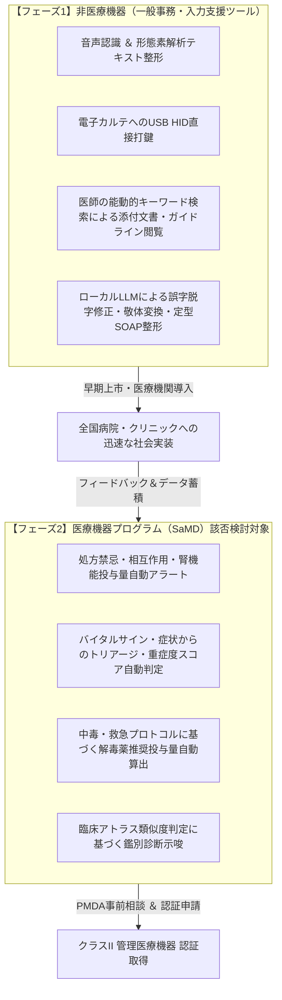

# 厚生労働省 医療系ベンチャー・トータルサポート事業（MEDISO）
# 相談申請書 兼 事業概要書（Webフォーム入力原稿 ＆ 面談提出資料）

**提出先**: 厚生労働省委託事業「医療系ベンチャー・トータルサポートオフィス」（受託者：株式会社三菱総合研究所）  
**申請フォームURL**: [https://mri.lmsg.jp/form/13980/wdh7L67n](https://mri.lmsg.jp/form/13980/wdh7L67n)  
**対象プロダクト**: DrVoice どんぐり君！ (Dr.Dongly / Drdonguri)  
**システム現行バージョン**: **v2.13.2** (デバイスファームウェア: **v22.4**)  
**公開WebUI (PWA)**: [https://yokawase.github.io/Drdonguri/](https://yokawase.github.io/Drdonguri/)  
**作成日**: 2026年10月20日  

---

## 【第1部】MEDISO Web申請フォーム（即時コピー＆ペースト用入力原稿）

※ `https://mri.lmsg.jp/form/13980/wdh7L67n` の各入力項目に対応しています。必要に応じて各項目をそのままフォームへ貼り付けてご活用いただけます。

| フォーム設問項目 | 入力推奨値 / 記入内容 |
| :--- | :--- |
| **個人情報の取扱い** | ☑ 同意する |
| **免責事項** | ☑ 同意する |
| **氏名** | （申請代表者 氏・名 を入力） |
| **氏名（フリガナ）** | （申請代表者 フリガナ を入力） |
| **所属先（企業名・大学名等）** | 株式会社MedArt / Dr.Dongly 開発プロジェクトチーム |
| **所属先住所** | （所属先の都道府県・市区町村・番地・建物名を入力） |
| **部署名** | 医療AI・ハードウェア開発部 |
| **役職** | 代表取締役 / 開発責任者 |
| **メールアドレス** | （連絡先メールアドレスを入力） |
| **電話番号** | （連絡先電話番号を入力） |
| **1. 所属先種別** | ◉ 【団体】企業（ベンチャー企業） ※会社設立前等の場合は【個人】起業家を選択 |
| **2. 問い合わせ内容** | ◉ 医療系ベンチャー・トータルサポートオフィスへのご相談 |
| **3. 相談製品の選択** | ◉ プログラム医療機器（SaMD） ※または「医療機器」 |
| **5. 情報提供メールの受取** | ◉ 情報提供メールを受け取る |
| **6. MEDISOを知った契機** | ☑ WEB検索 ☑ 講演やセミナーを通じて知った |
| **7. 閲覧Webメディア** | ☑ 日経メディカル ☑ m3.com ☑ 日経デジタルヘルス |

---

### 【項目4】「お問合せ内容を具体的に入力してください」貼り付け用テキスト

```text
【製品名】DrVoice どんぐり君！ (Dr.Dongly)
【製品形態】USBドングル（ESP32-S3搭載）＋ PWA型オンデバイス医療AIアプリケーション
【相談種別】プログラム医療機器（SaMD）該否判断、薬事承認・認証戦略、および知財・保険適用相談

【開発の背景と臨床の課題】
2024年4月からの「医師の働き方改革」に伴い、医師の長時間労働削減と医療記録業務の効率化は国家的な急務となっています。しかし、日本の電子カルテ端末は「医療情報システムの安全管理に関するガイドライン」に基づきインターネットから厳格に物理的・論理的に隔離されたクローズド閉域網で運用されており、既存のクラウド音声入力やクラウドLLMを導入することは極めて困難です（院外への患者情報流出リスク、病院情報システム管理者の許可の壁）。また、一般的なUSBメモリの持ち込みはマルウェア感染対策のため厳格に遮断されています。

【製品の概要と独自技術】
当社が開発した「DrVoice どんぐり君！（Dr.Dongly）」は、電子カルテ端末に一切の常駐ソフト（ドライバ/エージェント）をインストールすることなく、USBポートに直挿しするだけで即座に安全稼働する「完全オンプレミス型 医療音声入力＆臨床意思決定支援ドングル」です。
1. 電カル側からは「標準USB物理キーボード（HID）」および「標準テキストプリンタ（07h）」の複合機として認識され、マスストレージ（MSC）はUSB記述子レベルで完全無効化。病院のUSBセキュリティ監視（EDR）を通過し、一切の院内規程違反を起こしません。
2. 医師のスマートフォン（PWA）上で動作するブラウザ内WebGPUローカルLLM（Gemma 2 2B）および0.5ms形態素解析（Sudachi Mode C）により、院内・クラウドへのデータ送信ゼロで完全ローカルにてカルテテキスト生成・文章校正を実施。
3. ドングル内臓の32GB MicroSDには、Minds診療ガイドライン全450タイトル原本PDF、PMDA医薬品添付文書全文（約22,000件）、錠剤写真、臨床アトラス等を格納し、電子カルテ「印刷」コマンド経由で吸い上げたカルテテキストに基づき、処方禁忌や推奨治療法をBLE/ローカルWi-Fi経由で瞬時に医師端末へ逆提示します。

【MEDISOへの主なご相談事項】
1. 薬機法上のプログラム医療機器（SaMD）該当性の境界判断：
   - 本システムの基本機能である「音声認識・テキスト校正・USB打鍵入力支援」は非医療機器（一般事務機器/入力支援）と認識しておりますが、ドングル内に格納した臨床ガイドラインや医薬品添付文書に基づく「処方箋禁忌チェック」「臨床意思決定支援（CDSS）」「救急中毒プロトコル提示」等の機能を付加した場合のSaMD該否判断についてご助言をいただきたい。
2. 段階的上市（フェーズ分割）戦略の妥当性検証：
   - 第1段階（フェーズ1）として「非医療機器（カルテ記載支援・辞書検索ツール）」として迅速に全国医療機関へ普及・販売を開始し、第2段階（フェーズ2）としてCDSS機能を独立させた「プログラム医療機器（クラスII管理医療機器認証等）」としてPMDA事前相談および認証申請を進めるロードマップの妥当性。
3. 医療情報セキュリティガイドライン（3省2ガイドライン）および電子カルテベンダー接続における留意点。
4. 複合機（USB仮想プリンタ＋キーボード）による電子カルテ双方向データ連携機構の特許・知財戦略および将来的な診療報酬評価（医療DX推進加算等）への適合可能性。
```

---

## 【第2部】MEDISO面談・事前提出用「医療系ベンチャー・トータルサポート事業 相談概要書」

### 1. 基本情報
- **開発プロジェクト名**: DrVoice どんぐり君！ (Dr.Dongly / Drdonguri)
- **事業主体**: 株式会社MedArt / Dr.Dongly 開発プロジェクトチーム
- **事業ステージ**: シード・アーリー期（プロトタイプ完成・実機ファームウェアv22.4およびWebUI v2.13.2稼働中・テスト71件完備・公開PWAにて実証検証中）
- **対象診療科・利用環境**: 全診療科（総合診療、内科、救急、整形外科、精神科、皮膚科、小児科、在宅医療等）、病院外来・病棟・当直室・訪問診療先
- **相談担当希望サポーター領域**: 薬事・法規制（SaMD薬事戦略・PMDA対応）、知財・特許戦略、医療機器ビジネス・保険適用、医療情報システムセキュリティ

---

### 2. 開発の背景・解決しようとする医療現場の課題（臨床ニーズ）

#### ① 2024年「医師の働き方改革」とカルテ記載負担の爆発
- 2024年4月より医師の時間外労働上限規制が適用され、医師1人あたり1日平均1〜2時間を費やしている電子カルテ入力・退院時サマリー作成業務の効率化が喫緊の課題です。

#### ② 電子カルテ閉域網（Air-Gapped Network）の壁
- 医療機関の情報システムは、厚労省「医療情報システムの安全管理に関するガイドライン」に基づき、基幹ネットワーク（電子カルテ網）と外部インターネットが物理的または論理的に遮断されています。
- このため、市販のクラウド型音声入力サービスやクラウドLLM（ChatGPT、Claude等）を電子カルテ端末に導入・接続することは、情報漏洩リスクおよび病院情報システム部門のセキュリティ規定により原則不可能です。

#### ③ 院内USBセキュリティポリシー（EDR・マスストレージ禁止）の壁
- ランサムウェア侵入防止および患者個人情報（PHI）の持ち出し防止のため、多くの病院ではPCのUSBポートに対して「USBメモリ（マスストレージクラス: MSC）」の接続をハードウェア的または監視ソフトウェア（EDR/DLP）により一律禁止しています。

#### ④ 汎用IMEの誤変換・キーボードエミュレーションの文字化け・誤爆事故
- 従来のキーストローク送信ツール（ALT codes利用等）では、OSメニューバー脱落事故（Menu Bar Trap）、IMEのON/OFF状態による文字化け、EDRの異常キーストローク誤検知による端末フリーズが発生し、重大な医療インシデントのリスクとなっていました。

---

### 3. 本製品のソリューション・コア技術

「Dr.Dongly」は、以上の4大課題をハードウェア・ファームウェア・Web技術の融合により完全克服しました。

```
┌────────────────────────────────────────────────────────────────────────┐
│                        Dr.Dongly システム構造                          │
│                                                                        │
│  【医師の手元端末 (スマートフォン / タブレット PWA)】                   │
│   ・Web Speech API 音声認識 ＆ リアルタイム音声波形解析                │
│   ・0.5ms WASM形態素解析 (Vibrato / Sudachi Mode C 長単位結合)         │
│   ・完全オンデバイス WebGPU ローカルLLM (Gemma 2 2B)                   │
│   ・Google DeepMind EmbeddingGemma 2 (MRL 128d) セマンティック検索     │
│   ・10大医療データ高速ビューア (オフライン完全動作)                    │
│                                  │                                     │
│                     【BLE 5.0 / Wi-Fi SoftAP】                         │
│                                  │                                     │
│  【T-Dongle-S3 超小型USBハードウェア (ESP32-S3 + 32GB MicroSD)】       │
│   ・TinyUSB複合ドライバ: USB HID Keyboard (03h) + 仮想プリンタ (07h)   │
│   ・※ マスストレージ (MSC) はUSB記述子レベルで完全無効化 (EDR完全無風) │
│   ・v20.1 HYBRID物理打鍵エンジン (11ms 安全インターキー遅延)           │
│   ・32GB MicroSD (10大医療データ 29.8GB配分 / Zero-Write読取専用保護)  │
│                                  │                                     │
│                     【USBポート直挿し (物理結線)】                     │
│                                  │                                     │
│  【電子カルテ端末 (完全閉域網・追加ソフトウェア/ドライバ一切不要)】    │
│   ・標準USBキーボードとして直接打鍵 (SOAP・カルテ記載に超高速注入)     │
│   ・「印刷(Ctrl+P)」コマンドによりカルテテキストを安全吸い上げ         │
└────────────────────────────────────────────────────────────────────────┘
```

#### コア技術の特徴：
1. **完全ドライバレス・非侵襲接続**: 電子カルテPCに追加ソフトウェア、常駐エージェント、管理者権限は一切不要。OS標準のHIDキーボードドライバおよび標準テキストプリンタドライバのみで動作。
2. **マスストレージ（MSC）完全遮断**: 32GB MicroSDを搭載しながら、USB記述子（`usb_descriptors.c`）においてMSCエンドポイントを一切定義せず、ストレージクラスを完全に隠蔽。病院のセキュリティ監視システム（EDR/DLP）に抵触しません。
3. **v20.1 HYBRIDキーストローク（11ms遅延制御）**:
   - `[Z]`: 漢字熟語・自立語語幹 ➔ 熟語全体の正規化ローマ字打鍵 ➔ Space変換 ➔ Enter確定
   - `[K]`: 全角カタカナ ➔ 平仮名ローマ字打鍵 ➔ F7強制確定
   - `[H]`: 付属語（助詞/語尾/句読点） ➔ 平仮名ローマ字打鍵 ➔ 即時Enter確定 (Space禁止)
   - `[A]`: 半角英数・記号 ➔ IMEを介さずASCII直接送出 (F10確定)
   - ALT codesおよびF5キーコードを完全排除し、IME状態に左右されない超高速・無誤爆打鍵を実現。
4. **USB仮想プリンタ吸い上げ（特許出願対象技術）**:
   - 電子カルテ上のテキストを「印刷」するだけで、USBドングルのBulk OUTエンドポイントがデータを吸い上げ、BLE経由で医師のスマホへ転送。カルテ内容に応じた禁忌チェックや要約をローカルで実施。
5. **完全オンプレミス AI & 10大医療データポートフォリオ (32GB MicroSD 29.8GB)**:
   - Minds診療ガイドライン原本PDF（450タイトル）、PMDA添付文書全文（22,000品目）、錠剤写真、臨床アトラス、救急中毒プロトコル等をMicroSDに内包。
   - WebGPUローカルLLM（Gemma 2 2B）およびEmbeddingGemma 2によるセマンティック検索を医師端末のメモリ内で完結させ、通信を外部インターネットへ一切出さないゼロトラスト・ゼロリーク設計。

---

### 4. 薬事・法規制（SaMD）に関する相談の論点整理

厚生労働省「プログラムの医療機器該当性に関するガイドライン」に基づき、本システムの各機能について医療機器該当性を以下のように整理し、貴オフィスの専門的見解を求めます。



#### 論点①：フェーズ1機能の「非医療機器」該当性の確認
- 音声入力、SOAP整形、文章校正、および医師自身が検索して閲覧する添付文書・ガイドラインの電子辞書的ビューア機能は、「専ら医療事務・入力支援を行うものであり、疾病の診断・治療・予防を目的とした医学的判断を行うものではない」ことから、**医療機器に該当しない（非該当）**と整理できるか。

#### 論点②：フェーズ2機能（臨床意思決定支援: CDSS）のSaMDクラス分類
- 仮想プリンタ経由で取得したカルテテキストに対し、患者の病名・処方歴・アレルギー情報から「併用禁忌」「過量投与」「腎機能低下時の減量基準」等を自動検出し、医師へ警告を発する機能。
- 救急・中毒プロトコル（例: アセトアミノフェンODに対するRumack-Matthewノモグラム判定とNAC投与指示）の自動計算。
- これら機能は、厚労省ガイドラインの「リスク分類（クラスII等）」においてどのように評価されるか。医師の最終確認を前提とするCDSSであっても医療機器該当性ありとされる境界基準。

#### 論点③：機能分割アーキテクチャによる薬事戦略
- 本システムでは、コアとなる「入力支援・ドングルファームウェア」と、将来的な「SaMDモジュール（CDSS）」を明確に分離・独立モジュール化することが技術的に可能です。
- この構成により、まず非医療機器としてハードウェアおよび基本入力を早期に全国展開し、臨床エビデンスと医師ユーザーを獲得した上で、アドオンモジュールとしてSaMD認証を段階的に取得する戦略が薬事法規上適切であるか。

---

### 5. 知財・特許戦略

1. **出願予定特許の骨子**:
   - **名称**: 「医療情報端末入力連携システム、USBドングルデバイス、およびキーストローク生成プログラム」
   - **要旨**: 閉域網医療端末に対し、外部常駐ソフトをインストールすることなく、USB物理層でHIDキーボードと仮想プリンタを複合認識させ、標準印刷コマンドによるカルテテキストの吸い上げと、長単位形態素解析（Sudachi Mode C）に基づくHYBRIDキーストローク注入（音訓Space・F7・Enter・ASCII）による超高速・無誤爆双方向通信を実現する技術体系。
2. **意匠・商標**:
   - 商標「DrVoice」「どんぐり君」「Dr.Dongly」の出願方針。
   - ドングル外観（T-dongle-S3 LCD画面でのキャラクター「どんぐり君」ステータス表示）の意匠権。

---

### 6. 今後の開発スケジュール & 支援要望事項

| 開発・事業化フェーズ | 時期 | 主な実施内容 | MEDISOへの支援要望 |
| :--- | :--- | :--- | :--- |
| **フェーズ1-A (現在)** | 2026年Q4 | ファームウェアv22.4 / PWA v2.13.2 実機実証、協力医療機関でのパイロットテスト | 薬事該否（非該当）の論点整理、基本特許の先行技術調査助言 |
| **フェーズ1-B** | 2027年Q1 | 非医療機器版「Dr.Dongly」の製品化・量産（CE/TELEC認証）・販売開始 | 医療機関導入時のセキュリティ認証取得支援、販路開拓アドバイス |
| **フェーズ2-A** | 2027年Q2〜Q3 | CDSSモジュール（処方禁忌・中毒プロトコル）の臨床試験・性能評価設計 | PMDA薬事戦略相談・対面助言の準備支援、医療機器該当性確認 |
| **フェーズ2-B** | 2027年Q4〜 | プログラム医療機器（SaMD クラスII）認証申請、保険適用（診療報酬）検討 | 認証申請書の作成指導、保険医療材料・特定保険医療材料/加算交渉戦略 |

---

### 7. MEDISOサポーターへの具体的な質問リスト

1. **【薬事・SaMD】**:
   - 「電子カルテからのテキスト吸い上げに基づき、PMDA添付文書記載の禁忌事項を表示する機能」は、単なる公的情報の引用表示であってもSaMDに該当するか、それとも「医師の判断支援に資する情報提示（非該当）」と解釈可能か。
   - PMDAの「プログラム医療機器（SaMD）該当性相談」に申請するにあたり、事前に準備すべき性能試験データおよびリスクマネジメント資料（ISO 14971準拠）の具体的水準。
2. **【セキュリティ・医療DX】**:
   - 「USBポートに挿入するハードウェアドングル」を医療機関が導入する際、病院IT部門・情報システム委員会（CIO）の承認を円滑に得るための第三者セキュリティ検証（ペネトレーションテスト、3省2ガイドラインチェックリスト等）のベストプラクティス。
3. **【知財・事業戦略】**:
   - 医療用USBドングル＋PWA複合システムの知財ポートフォリオ構築において、大手電子カルテベンダー（富士通、PHC、ソフトウェア・サービス等）との競合・アライアンスを想定した場合の特許防衛戦略。
4. **【保険適用・診療報酬】**:
   - 本システムの導入により医師のカルテ入力時間が削減され医療安全が向上する場合、医療機関側が算定可能な既存の診療報酬項目（医療DX推進体制整備加算、外来・感染対策向上加算等）への紐付け、あるいは将来的な新技術評価の可能性。
