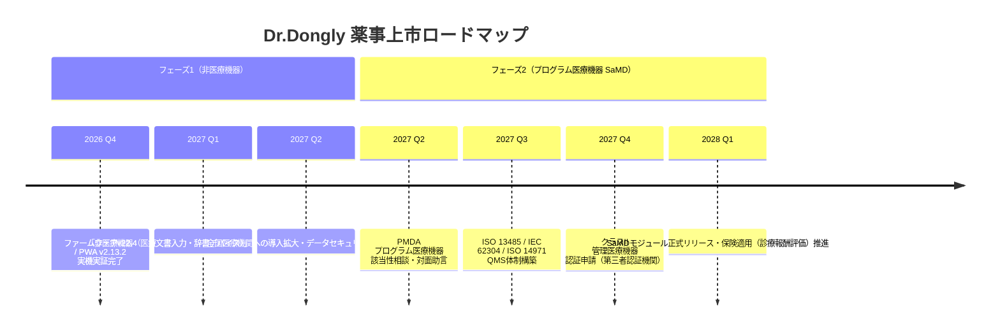

# DrVoice どんぐり君！（Dr.Dongly）
# 薬機法・プログラム医療機器（SaMD）該否判断 & 薬事・セキュリティ戦略書

**文書管理番号**: MEDART-DRD-REG-2026-V10  
**対象システム**: DrVoice どんぐり君！ (Dr.Dongly / Drdonguri)  
**システムバージョン**: v2.13.2 / ファームウェア v22.4  
**提出先 / 協議先**: 厚生労働省 MEDISO（医療系ベンチャー・トータルサポート事業） / 独立行政法人 医薬品医療機器総合機構（PMDA）  
**作成日**: 2026年10月20日  

---

## 1. エグゼクティブサマリー

「DrVoice どんぐり君！（Dr.Dongly）」は、医療用電子カルテ端末が置かれた強固な閉域網（Air-Gapped Network）環境において、医師のスマートフォン（PWA）からUSB-HID（キーボード）物理層を介して、超高速・無誤爆で医療記録を入力・転送する「完全オンプレミス型 医療音声入力＆臨床支援デバイス」です。

本戦略書は、厚生労働省策定の「プログラムの医療機器該当性に関するガイドライン」および「医療情報システムの安全管理に関するガイドライン 第6.0版」に基づき、本システムの全機能に対する薬機法上の医療機器プログラム（SaMD: Software as a Medical Device）該当性の論点を整理し、**「フェーズ1: 非医療機器としての迅速な社会実装」**と**「フェーズ2: 高度臨床意思決定支援（CDSS）モジュールのSaMD認証取得」**からなる2段階上市戦略を策定したものです。

---

## 2. 厚労省ガイドラインに基づく機能別 医療機器該否判定マトリクス

厚生労働省「プログラムの医療機器該当性に関するガイドライン」（令和3年3月31日 薬生機審発0331第1号、令和5年3月改訂）のフローチャートおよび判断基準に照らし、Dr.Donglyが有する機能群を分類・評価しました。

| 機能モジュール | 機能の詳細内容 | 判定基準（ガイドライン照合） | 薬機法上の該当性 | 上市フェーズ |
| :--- | :--- | :--- | :--- | :--- |
| **① 音声認識・入力支援** | Web Speech API による音声のテキスト化、リアルタイム波形表示 | 単なるデータ入力インターフェースの補助。医療事務作業の効率化であり、疾病の診断・治療に直接関与しない。 | **非該当 (非医療機器)** | **フェーズ1** (即時) |
| **② 長単位形態素解析** | Vibrato WASM / Sudachi Mode C による医学用語分断防止・自立語語幹分離 | IME辞書・自然言語処理エンジン。ユーザー（医師）が意図した文字列への変換補助に留まる。 | **非該当 (非医療機器)** | **フェーズ1** (即時) |
| **③ USB-HID打鍵エンジン** | v20.1 HYBRIDキーストロークによる電子カルテ端末への直接物理打鍵（11ms遅延制御） | 外付けキーボードハードウェアと同等の物理入力デバイス。 | **非該当 (非医療機器)** | **フェーズ1** (即時) |
| **④ 文章校正・SOAP整形** | WebGPU ローカルLLM (Gemma 2 2B) による誤字脱字修正、敬体・常体統一、SOAP形式整理 | 文書作成支援（ワープロソフトの校正機能と同視）。医師の診療記録作成を支援する医療事務ツール。 | **非該当 (非医療機器)** | **フェーズ1** (即時) |
| **⑤ 医療情報電子辞書・ビューア** | 32GB MicroSDに格納されたPMDA添付文書、Mindsガイドライン、臨床アトラスの閲覧 | 既刊の医学文献・公的資料の電子的表示。医師が自らの判断で検索・参照する情報提供ツール。 | **非該当 (非医療機器)** | **フェーズ1** (即時) |
| **⑥ 仮想プリンタ吸い上げ** | 電子カルテ「印刷」コマンド経由でのカルテテキスト取得（Bulk OUT ➔ BLE） | 電子カルテと医師手元端末間の通信・転送機能（データパイプライン）。 | **非該当 (非医療機器)** | **フェーズ1** (即時) |
| **⑦ 処方禁忌・相互作用アラート** | カルテ上の処方薬と病名・併用薬を自動照合し、添付文書記載の「禁忌」を自動検出・警告 | 患者個別のデータを元にリスクを自動演算・提示。医師の判断を誘導・支援する性質を持つ。 | **境界領域 〜 SaMD該当 (クラスII検討)** | **フェーズ2** |
| **⑧ 救急・中毒プロトコル計算** | アセトアミノフェンOD時のRumack-Matthewノモグラム自動プロット、NAC投与量算出 | 個別患者の血中濃度・摂取量から解毒処置の適否・投与量を自動算出する機能。 | **SaMD該当 (クラスII 管理医療機器)** | **フェーズ2** |
| **⑨ 臨床アトラス画像類似度判定** | 皮疹・ECG画像等とライブラリ画像のセマンティックベクトル照合による鑑別示唆 | 画像解析に基づく診断補助機能。 | **SaMD該当 (クラスII〜III)** | **フェーズ2** (将来) |

---

## 3. 2段階（フェーズ分割）薬事上市戦略

医療機器プログラム（SaMD）の承認・認証プロセスは通常1〜2年を要し、多大な開発・審査コストが発生します。一方で、臨床現場（特に2024年医師働き方改革下）におけるカルテ入力負担の軽減は「今すぐ」必要とされています。

この課題を解決するため、本プロジェクトでは**機能の論理的・構造的分離アーキテクチャ**を採用し、以下の2段階戦略を推進します。



### 【フェーズ1】：非医療機器としての先行社会実装（2026年Q4〜2027年Q1）
- **対象製品**: Dr.Dongly ハードウェアドングル ＋ 基本PWA入力エディタ ＋ 電子辞書検索ビューア
- **薬機法上の位置づけ**: **一般医療機器・管理医療機器・SaMDのいずれにも該当しない（非該当品）**
  - 電子カルテへの物理HID入力、長単位形態素解析、WebGPUローカルLLMによるSOAP文章整形、公的添付文書・Mindsガイドラインの電子的閲覧に機能を限定。
  - 医療機関は届出・承認不要で一般購買・備品購入として即座に導入可能。
- **ビジネス効果**:
  - 先行して収益化を達成し、医師ユーザーベースと臨床現場からのフィードバックを確立。
  - 電子カルテ閉域網におけるハードウェアの安全性・安定稼働のエビデンスを蓄積。

### 【フェーズ2】：高度臨床意思決定支援（CDSS）モジュールのSaMD認証（2027年Q2〜）
- **対象モジュール**: 「Dr.Dongly MedPilot CDS オプション」
- **薬機法上の位置づけ**: **指定管理医療機器（プログラム医療機器 クラスII）**
  - 処方箋禁忌・相互作用自動アラート、腎機能投与量自動アジャスト、救急中毒プロトコル自動計算。
  - ソフトウェアアーキテクチャとして、フェーズ1の基本入力エンジンから明確にAPI分離・プラグイン化し、医療機器モジュールのみをQMS（IEC 62304 / ISO 13485）管理下で製造販売。
- **承認・認証戦略**:
  - 登録認証機関（BSI、テュフズード、テュフラインランド等）による第三者認証基準に合致するか、既存の「汎用画像診断装置ワークステーション用プログラム」や「医薬品処方監査支援プログラム」の認証基準を準用できるかMEDISOおよびPMDA相談にて確認。

---

## 4. 医療情報セキュリティ（3省2ガイドライン）適合性評価

厚生労働省・総務省・経済産業省「医療情報システムの安全管理に関するガイドライン 第6.0版（令和5年5月）」に対する本システムの適合性を以下のように実証します。

```
┌────────────────────────────────────────────────────────────────────────┐
│               3省2ガイドライン対策：3大セキュリティ障壁の克服           │
├────────────────────────────────┬───────────────────────────────────────┤
│ ガイドライン要求事項 / 院内規定│ Dr.Dongly の技術的克服アプローチ      │
├────────────────────────────────┼───────────────────────────────────────┤
│ ① マスストレージ (USBメモリ)  │ TinyUSBドライバレベルでMSCクラスを    │
│    持ち込みの厳格禁止          │ 完全遮断。OSにはKeyboard(03h)と       │
│    (マルウェア侵入・情報持出)  │ Printer(07h)のみ認識させ、ストレージ  │
│    （第6.0版 6.3「外部媒体の管理」）│ ドライブ文字（D:, E:等）を一切生起させない│
├────────────────────────────────┼───────────────────────────────────────┤
│ ② 閉域網からの患者個人情報    │ WebGPUローカルLLM (Gemma 2 2B) および │
│    (PHI) の外部流出防止        │ 0.5ms形態素解析を医師手元端末内で完結。│
│    （第6.0版 6.2「ネットワーク」） │ 外部インターネットへの通信パケットゼロ│
│                                │ （Zero-Cloud / Local-First ゼロリーク） │
├────────────────────────────────┼───────────────────────────────────────┤
│ ③ 電子カルテ端末への          │ 専用エージェントソフト等のインストール │
│    未承認プログラム導入禁止    │ 不要。Windows標準HID/プリンタドライバ │
│    （第6.0版 6.5「ソフトウェア管理」）│ のみを使用し、管理者権限（UAC）不要   │
└────────────────────────────────┴───────────────────────────────────────┘
```

---

## 5. PMDA（医薬品医療機器総合機構）相談に向けた準備計画

MEDISOの支援を受け、以下のステップでPMDA相談を実施します。

1. **プログラム医療機器（SaMD）該当性相談**:
   - 目的: フェーズ1機能（文章校正・辞書表示）が確実に非医療機器であることの公的合意形成、およびフェーズ2機能（処方禁忌・CDSS）が該当する一般的名称・クラス分類の特定。
   - 準備資料:
     - 開発経緯・システム構成図・機能一覧
     - ユーザーインターフェース画面推移図
     - 入力データ（カルテテキスト）と出力データ（警告表示）の因果関係説明書
     - 医師の介入（医師が自らの医学的判断で承認・却下するプロセス）のUI設計書
2. **QMS（品質マネジメントシステム）体制の構築**:
   - **IEC 62304**: 医療機器ソフトウェア - ソフトウェアライフサイクルプロセス（安全性クラスAまたはBの適用評価）
   - **ISO 14971**: 医療機器 - リスクマネジメントの適用（キーストローク誤爆による誤記載リスク、禁忌見逃しリスクの低減策）
   - **JIS T 2304**: 日本産業規格への適合文書作成

---

## 6. 知財（特許）戦略と参入障壁の構築

本システムが保有する独自技術について、以下の特許ポートフォリオを構築します。

1. **基本特許（出願準備中）**:
   - **発明の名称**: 医療情報端末入力連携システム、USBドングルデバイス、およびキーストローク生成プログラム
   - **請求の範囲の要点**:
     - 閉域網医療端末に対し、外部ソフトウェアを常駐させることなく、単一のUSBポートからHIDキーボードと仮想プリンタを複合デバイスとして認識させる点。
     - 端末の標準印刷コマンドによるカルテテキストの吸い上げと、長単位形態素解析（Sudachi Mode C）に基づくローマ字・F7・Space・Enterの最適な組み合わせによるHYBRIDキーストローク生成。
     - 物理キーボード打鍵における11ms遅延制御およびALT codes排除によるIMEトラップ防止機構。
2. **参入障壁と防衛戦略**:
   - 大手電子カルテベンダーが独自に音声入力を開発する場合でも、「USBポート直挿し物理打鍵」「閉域網における完全オンプレミスLLM連携」の基本特許を押さえることで、強力な協業・ライセンス供与のポジションを確保します。
