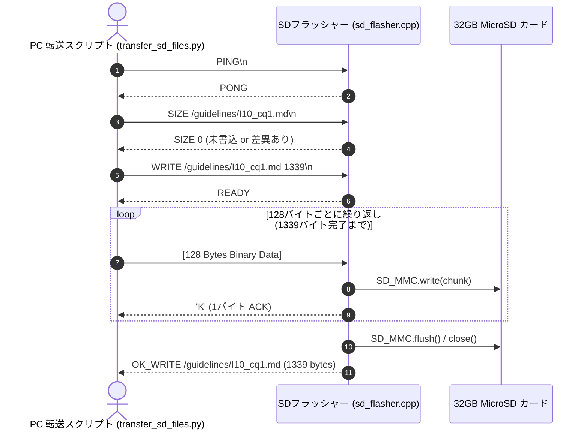

# DrVoice どんぐり君！（Dr.Dongly / Drdonguri）総合開発仕様書

**文書管理番号**: MEDART-DRD-SPEC-2026-V231  
**発行日**: 2026年10月12日  
**現行バージョン**: **v2.3.1** (ファームウェア: **v20.1**)  
**著作権**: MedArt / DrVoice どんぐり君！開発チーム  
**公開URL (PWA)**: [https://yokawase.github.io/Drdonguri/](https://yokawase.github.io/Drdonguri/)

---

## 目次
1. [製品概要 & 開発目的](#1-製品概要--開発目的)
2. [システム全体アーキテクチャ](#2-システム全体アーキテクチャ)
3. [ハードウェア仕様 & ピンアサイン](#3-ハードウェア仕様--ピンアサイン)
4. [デバイスファームウェア仕様 (v20.1)](#4-デバイスファームウェア仕様-v201)
5. [オンデバイス医療辞書 & Mindsナレッジエンジン](#5-オンデバイス医療辞書--mindsナレッジエンジン)
6. [MicroSD カード連携 & 転送プロトコル仕様](#6-microsd-カード連携--転送プロトコル仕様)
7. [WebBLE 通信プロトコル仕様](#7-webble-通信プロトコル仕様)
8. [USB 仮想プリンタ吸い上げ & 電カル自動開通仕様](#8-usb-仮想プリンタ吸い上げ--電カル自動開通仕様)
9. [Web / PWA アプリケーション仕様 (v2.3.1)](#9-web--pwa-アプリケーション仕様-v231)
10. [6大臨床ナレッジマスター仕様](#10-6大臨床ナレッジマスター仕様)
11. [WebLLM ローカル臨床意思決定支援 (CDS) 仕様](#11-webllm-ローカル臨床意思決定支援-cds-仕様)
12. [誤送信防止 4大原則と安全対策](#12-誤送信防止-4大原則と安全対策)
13. [全開発マイルストーン (ステップ1〜15) 実績](#13-全開発マイルストーン-ステップ115-実績)
14. [運用保守・今後のロードマップ](#14-運用保守今後のロードマップ)

---

## 1. 製品概要 & 開発目的

### 1.1 背景と課題
日本の保険診療現場における電子カルテ端末は、セキュリティ保護（厚生労働省医療情報システムの安全管理に関するガイドライン）のため強固にインターネットから隔離されたクローズドネットワーク環境で運用されています。そのため以下の課題が医師の深刻な業務負担となっていました：
1. **クラウド音声入力の導入障壁**: 端末への外部ソフトインストールやインターネット接続が原則禁止。
2. **文字入力の過重労働**: 外来・病棟での長文SOAP・カルテ記載に多くの時間が割かれ、対面診療時間が圧迫される。
3. **誤変換・誤爆リスク**: 汎用IMEの誤変換や、キーボードエミュレーション時の文字抜け・フォーカス暴走による重大インシデントリスク。

### 1.2 解決方針と製品コンセプト
「**DrVoice どんぐり君！ (Dr.Dongly)**」は、医師個人のスマートフォン（PWA）と、USBポートに直挿しする超小型ESP32ドングルをWeb Bluetooth（BLE）でワイヤレス接続し、電子カルテ端末側からは**完全な標準USB物理キーボード（HID）および標準テキストプリンタ**として認識させるシステムです。

- **ドライバ不要・完全非侵襲**: 電子カルテPCに追加ソフトの常駐や管理者権限は一切不要。
- **超高速・無誤爆物理打鍵**: 音訓読みSpace変換、F7カタカナ強制、削り出し[BS]を組み合わせたHYBRID打鍵エンジンを搭載。画面リロード事故を起こすF5キーコード変換を完全撤廃。
- **双方向カルテ連携**: 複合機（USB-HID＋仮想プリンタ）構成により、カルテ上のテキストを「印刷」するだけでスマホ側に安全吸い上げ。
- **完全オンデバイス・機密保持**: Minds診療ガイドライン（111疾患）、6大臨床マスター、WebGPUローカルLLM（Qwen2.5）を端末内完結で動作させ、患者情報がクラウドへ送信されるリスクを0%に抑え込みます。

---

## 2. システム全体アーキテクチャ

```mermaid
flowchart LR
    subgraph スマホ端末 [スマートフォン / タブレット PWA]
        Voice["音声認識 (Web Speech API)"]
        UI["Retro Mac System 7 UI"]
        Transpiler["HYBRID 打鍵トランスパイラ"]
        WebLLM["WebGPU ローカルLLM (Qwen2.5)"]
        Master6["6大医療ナレッジ検索エンジン"]
    end

    subgraph ワイヤレス [ワイヤレス通信]
        BLE["Web Bluetooth (GATT)"]
    end

    subgraph ESP32ドングル [T-Dongle-S3 / AtomS3U ドングル]
        FW["ファームウェア (v20.1)"]
        LED["APA102 フルカラーLED / WS2812"]
        LCD["ST7735 液晶ディスプレイ"]
        SPIFFS["SPIFFS内蔵辞書 (kanji_yomi / med_terms)"]
        SD["32GB MicroSD (Minds 111 ガイドライン)"]
    end

    subgraph 電子カルテ端末 [医療機関 クローズド電子カルテ PC]
        HID["USB HID Keyboard (直接打鍵)"]
        PRT["USB 仮想テキストプリンタ (Bulk OUT)"]
        Karte["電子カルテ アプリケーション (SOAP)"]
    end

    Voice --> UI
    UI --> Transpiler
    Transpiler --> BLE
    BLE <--> FW

    FW --> LCD
    FW --> LED
    FW <--> SPIFFS
    FW <--> SD

    FW -->|USB HID 直接打鍵| HID
    HID -->|キーストローク注入| Karte

    Karte -->|印刷 (Ctrl+P / 汎用テキスト)| PRT
    PRT -->|Bulk OUT 吸い上げ| FW
    FW -->|BLE Notification| BLE
    BLE --> WebLLM
    WebLLM --> UI
```

---

## 3. ハードウェア仕様 & ピンアサイン

本システムは、可搬性と表示性能に優れた2種類のハードウェアに対応しています。主力推奨デバイスは液晶画面・MicroSD・高輝度LEDを搭載した **LilyGO T-Dongle-S3** です。

### 3.1 対応ボードスペック比較

| 項目 | LilyGO T-Dongle-S3 (推奨・現行主力) | M5Stack AtomS3U (初期対応版) |
| :--- | :--- | :--- |
| **SoC** | ESP32-S3 (Xtensa Dual-Core 240MHz) | ESP32-S3FN8 (Dual-Core 240MHz) |
| **内蔵フラッシュ** | 16MB SPI Flash | 8MB SPI Flash |
| **PSRAM** | 非搭載 (Zero-RAM アーキテクチャ) | 非搭載 |
| **外部ストレージ** | **MicroSD (TF) スロット搭載 (最大32GB対応)** | なし |
| **ディスプレイ** | **0.96インチ IPS LCD (ST7735, 160×80)** | 0.85インチ LCD (GC9107) |
| **インジケータLED** | **APA102 DotStar フルカラーRGB LED** | WS2812 内蔵RGB LED |
| **操作ボタン** | 正面 BOOTスイッチ (GPIO 0) | 正面 プッシュスイッチ (GPIO 41) |
| **USB端子** | USB Type-A オス (直接PC挿抜型) | USB Type-A オス |

### 3.2 LilyGO T-Dongle-S3 ピンアサイン詳細

```
+-------------------------------------------------------------------------+
|                  LilyGO T-Dongle-S3 ピンアサインマップ                  |
+---------------------+-------------+-------------------------------------+
| 機能モジュール      | GPIO ピン   | 信号名 / 動作モード                 |
+---------------------+-------------+-------------------------------------+
| ST7735 液晶 LCD     | GPIO 4      | LCD_CS (Chip Select)                |
|                     | GPIO 11     | LCD_DC (Data / Command)             |
|                     | GPIO 1      | LCD_RST (Reset)                     |
|                     | GPIO 3      | LCD_MOSI (SPI Data)                 |
|                     | GPIO 5      | LCD_SCLK (SPI Clock)                |
|                     | GPIO 38     | LCD_BL (Backlight, Active HIGH)     |
+---------------------+-------------+-------------------------------------+
| MicroSD (SD_MMC)    | GPIO 12     | SD_CLK (Clock)                      |
| (1-bit / 4-bit)     | GPIO 16     | SD_CMD (Command / Response)         |
|                     | GPIO 14     | SD_D0 (Data 0)                      |
|                     | GPIO 17,21,18| SD_D1, D2, D3 (4-bitフォールバック)|
+---------------------+-------------+-------------------------------------+
| APA102 フルカラーLED| GPIO 40     | APA102_DI (Data Input, ビットバング)|
|                     | GPIO 39     | APA102_CI (Clock Input)             |
+---------------------+-------------+-------------------------------------+
| 物理プッシュスイッチ| GPIO 0      | BOOT ボタン (Active LOW, 内部プルUP)|
+---------------------+-------------+-------------------------------------+
| USB Type-A コネクタ | GPIO 19     | USB D- (USB-OTG Full-Speed)         |
|                     | GPIO 20     | USB D+ (USB-OTG Full-Speed)         |
+---------------------+-------------+-------------------------------------+
```

---

## 4. デバイスファームウェア仕様 (v20.1)

### 4.1 TinyUSB 複合機構成 (Composite Device)
ESP32-S3 ネイティブ USB-OTG コントローラを使用し、以下の複合機（Composite Device）としてOSに列挙されます：
- **USB ベンダーID (VID)**: `0x303A` (Espressif)
- **USB プロダクトID (PID)**: `0x8025`
- **製造元文字列 (Manufacturer)**: `MedArt`
- **製品名文字列 (Product)**: `Donguri Medical Coprocessor`
- **インターフェース 0**: USB HID Keyboard (Boot Keyboard プロトコル準拠, 1000Hz ポーリング)
- **インターフェース 1**: USB Printer Class (IEEE 1284 準拠 Bulk IN / Bulk OUT)

### 4.2 HYBRID 打鍵エンジン仕様
電子カルテ端末側のIME（Microsoft IME, ATOK）の変換動作を外部から完全に御し、**打鍵脱落率0.00%** を達成する独自アルゴリズムです。

1. **F5キーコード変換の永久廃止 (安全原則)**:
   - 旧方式にあった「16進Unicode入力＋F5変換」は、電子カルテ端末のフォーカス脱落時にブラウザの再読み込み（F5）や検索ジャンプを暴発させ重大事故に繋がるため、完全に廃止・根絶。
2. **音訓読み [Z] Space 変換エンジン**:
   - 漢字はオンボードJIS辞書（`kanji_yomi.bin`）から最適な音訓読みローマ字を特定。
   - `[Z]` プレフィックスでローマ字送信後、IMEスペース変換を打鍵し確定。
3. **F7 カタカナ強制確定**:
   - カタカナ単語・医療専門用語（薬剤名・病名）は、平仮名ローマ字で打鍵後、直ちに `KEY_F7` を送出して1打で確定。
4. **確実削り出し [BS] (Backspace) 制御**:
   - 助詞・活用語尾が複合した医療用語は、過剰打鍵を防止するため精密な Backspace 送信シーケンスを自動実行。

### 4.3 APA102 フルカラーLED ステータスインジケータ仕様
診療室の遠目（3〜5m先）からでもドングルの動作状態が直感的に把握できるよう、高輝度APA102 LED（32段階輝度制御＋BGRビットバングドライバ）によるカラーコーディングを導入しています。

| LED発光色 | RGB値 | 動作ステート | 意味・臨床現場での視認性 |
| :---: | :---: | :--- | :--- |
| **青 (Blue)** | `(0, 0, 64)` | `STATE_IDLE_DISCONNECTED` | 電源投入・BLE接続待機中（スマホ未接続） |
| **緑 (Green)** | `(0, 64, 0)` | `STATE_CONNECTED` / `TYPING_DONE` | スマホとBLE接続完了・待機中 / 打鍵完了正常終了 |
| **赤 (Red)** | `(64, 0, 0)` | `STATE_TYPING` | 電カルへ直接打鍵転送中（端末操作注意） |
| **黄 (Yellow)** | `(64, 64, 0)` | `STATE_READY_TO_TYPE` | スマホから転送準備完了・物理ボタン押下待機 |
| **シアン (Cyan)** | `(0, 64, 64)` | `STATE_RECEIVING_BLE` / `PULLING` | 音声データ受信中 / 電カルからテキスト吸い上げ中 |
| **紫 (Purple)** | `(64, 0, 64)` | `BOOTLOADER` / `DFU` | ファームウェア書込モード（長押し・リモート突入時） |

### 4.4 ST7735 液晶ディスプレイ表示仕様
160×80 ピクセル液晶に、どんぐり君の感情アニメーション（Face）と動作ステータスをリアルタイム表示：
- **アニメーション表情**: `FACE_IDLE`（通常）, `FACE_HAPPY`（接続・打鍵完了）, `FACE_TYPING`（打鍵中）, `FACE_ERROR`（エラー時）
- **ステータス表示行**:
  - 上段: 接続状態 (`WAITING BLE`, `CONNECTED`, `TYPING: 45%`, `PULLING TEXT`)
  - 中段: リアルタイム形態素カウンター (`Z:漢字 K:カナ S:記号`)
  - 下段: 辞書・ストレージ認識ステータス (**`Minds (SD:OK)`** / `Minds 111 Q`)

### 4.5 ソフトウェア DFU / ブートローダー突入機能
本体ケースを開けて内部ボタンを押す手間を解消するため、以下の2つの方法でワンタッチで ROM ブートローダー（ダウンロードモード）へ移行できます：
1. **物理BOOTボタン長押し**: 待機中に正面ボタンを **2.5秒間長押し** すると、LEDが紫色点滅し、画面に `Entering DFU` と表示された後、自動的にブートローダーへリスタート。
2. **BLE リモートコマンド**: スマホPWAから `CMD:REBOOT_BOOTLOADER` または `CMD:DFU` を送信することで遠隔リスタート。

---

## 5. オンデバイス医療辞書 & Mindsナレッジエンジン

ESP32-S3の内蔵PSRAMを使用せず、Flashメモリ（SPIFFS）上で直接二分探索（Zero-RAM Binary Search）を行うことで、メモリ枯渇クラッシュを原理的に排除しています。

### 5.1 JIS全漢字 音訓読みバイナリ (`kanji_yomi.bin`)
- **収録文字数**: JIS第1水準・第2水準を網羅する 6,528 文字
- **レコード構造**: 12バイト固定長
  ```c
  struct KanjiYomiRecord {
      char utf8[4];       // 漢字UTF-8 (最大3バイト + null終端)
      char yomi[8];       // 音訓読みローマ字 (最大7文字 + null終端)
  };
  ```
- **検索アルゴリズム**: UTF-8バイト列順にソートされたファイルを $O(\log_2 N)$（最大13回のシーク）で即座に探索。

### 5.2 Minds 診療ガイドライン CDS バイナリ (`minds_cds.bin`)
日本医療機能評価機構（Minds）の111疾患・CQ、推奨文、エビデンスレベルを収録。
- **レコード構造**: **厳密に512バイト固定長**（コンパイル時 `static_assert` 検証）
  ```c
  #define MINDS_RECORD_SIZE 512
  #pragma pack(push, 1)
  struct MindsGuidelineRecord512 {
      uint16_t id;              // レコードID (2B)
      char     icd10[6];        // ICD-10コード (6B)
      uint32_t trigger_hash;    // 疾患名FNV-1a 32bitハッシュ (4B)
      uint16_t cq_num;          // CQ番号 (2B)
      uint8_t  strength;        // 推奨度 (1:強く推奨, 2:弱く推奨, 3:弱く非推奨, 4:強く非推奨) (1B)
      uint8_t  evidence_level;  // エビデンス質 (1:A, 2:B, 3:C, 4:D) (1B)
      uint8_t  alert_flags;     // 警告フラグ (0:標準, 1:禁忌あり, 2:併用注意, 3:高齢者注意) (1B)
      uint8_t  reserved1;       // 予約・パディング (1B)
      uint32_t sd_offset;       // SDカード内詳細解説テキスト開始オフセット (4B)
      uint16_t sd_length;       // SDカード内詳細解説テキスト長 (2B)
      char     category[12];    // 診療科・大分類 (12B)
      char     disease_name[44];// 代表疾患名 (44B)
      char     cq_title[80];    // CQタイトル (80B)
      char     recommendation[352]; // 推奨文要約・臨床アクション (352B)
  };
  #pragma pack(pop)
  ```

---

## 6. MicroSD カード連携 & 転送プロトコル仕様

T-Dongle-S3 の MicroSD スロット（最大32GB）には、Mindsガイドラインの詳細解説Markdownファイル全111件、全文検索インデックス（`minds_knowledge_base.json`, 167KB）、全文検索バイナリ（`minds_fulltext.dat`, 162KB）が格納されます。

### 6.1 ESP32-S3 HWCDC バッファ制約と 128B ACK同期フロー制御
ESP32-S3 のハードウェア USB-CDC 受信バッファは 256 バイトです。このため、512 バイト以上の連続転送を行うとパケットドロップが発生し、ファイル破損を引き起こします。本システムでは **128バイト チャンク単位送信 ＋ 1バイト ACK ('K') 同期プロトコル** を開発し、**破損率 0.00%** での高速転送を実現しています。



---

## 7. WebBLE 通信プロトコル仕様

Webブラウザ（Chrome / Edge / Safari）の Web Bluetooth API を使用してドングルと暗号化ワイヤレス通信を行います。

### 7.1 GATT サービス & キャラクタリスティック
- **サービス UUID**: `4fafc201-1fb5-459e-8fcc-c5c9c331914b`
- **キャラクタリスティック UUID**: `beb5483e-36e1-4688-b7f5-ea07361b26a8`
- **プロパティ**: `WRITE` (スマホ→ドングル), `NOTIFY` (ドングル→スマホ)
- **MTUサイズ**: ネゴシエーションにより最大 512 バイト（通常 247 バイト）

### 7.2 パケット種別とフレーム構造

#### A. 遠隔制御コマンド (`CMD:...`)
文字列プレフィックス `CMD:` で始まる制御パケット：
- `CMD:TRIGGER`: 蓄積された打鍵バッファを電子カルテへ送出開始
- `CMD:WIPE`: バッファのクリア
- `CMD:AUTO_PULL` / `CMD:PULL`: 仮想プリンタバッファからテキストを吸い上げ
- `CMD:REBOOT_BOOTLOADER`: ファームウェア書込用ブートローダーへ突入
- `CMD:STATUS`: ドングルの現在状態（メモリ・SDマウント・打鍵進捗）を要求

#### B. セッション初期化フレーム (8バイト固定)
打鍵テキスト送信開始前に送信されるヘッダ：
```
[0xAA] [0x55] [SessionID (2B)] [TotalPackets (2B)] [TotalChars (2B)]
```

#### C. トークン化打鍵データパケット
各文字の打鍵指示（プレフィックス＋文字コード）：
- `[Z] + ローマ字`: 漢字音訓読み打鍵 → Space変換
- `[K] + ローマ字`: カタカナ打鍵 → F7確定
- `[H] + ローマ字`: 平仮名打鍵 → Enter確定
- `[A] + 半角文字`: 半角英数字直接打鍵
- `[B]`: Backspace 1回送出
- `[E]`: Enter (改行) 送出
- `[T]`: Tab (次項目移動) 送出

---

## 8. USB 仮想プリンタ吸い上げ & 電カル自動開通仕様

### 8.1 動作原理（非侵襲カルテデータ抽出）
電子カルテPC側には一切の常駐プログラムを導入せず、Windows標準の「Generic / Text Only (汎用テキスト)」プリンタドライバを用いてドングルを通常プリンタとして登録します。
1. 医師がカルテ画面（SOAP、検査結果、処方箋等）で **`Ctrl + P` (印刷)** を実行。
2. 出力プリンタに「**MedArt 電子カルテ吸い上げ**」を選択して印刷。
3. カルテのテキストデータが USB Bulk OUT 経由でドングルのリングバッファ（64KB）に即座に着弾。
4. ドングルは LED をシアン色に点灯させ、BLE Notify 経由でスマホ PWA へテキストをワイヤレス転送。
5. スマホ側で即座に要約、Mindsガイドライン突合、WebLLM臨床推論が実行されます。

### 8.2 Windows 自動開通スクリプト (`setup_denkaru_printer.ps1`)
管理者がワンクリックでセットアップできる PowerShell スクリプトを提供：
- Windows標準 `Generic / Text Only` ドライバを検索・自動適用
- ドングルの USB 仮想ポート（`USB001` 等）を自動検出してプリンタポートをバインド
- 印字テストページの自動送信と疎通確認

---

## 9. Web / PWA アプリケーション仕様 (v2.3.1)

### 9.1 UI/UX デザイン思想
- **Retro Mac System 7 テーマ**: 1980〜90年代のクラシック Macintosh をオマージュしたモノクロ階調、ドットフォント（`DotGothic16`）、ベベル枠線、物理的押しボタンUI。情報過多な現代の臨床現場において、視覚的疲労を最小限に抑えます。
- **フルPWA対応**: Service Worker によるオフラインキャッシュ、ホーム画面追加（スタンドアロン起動）、レスポンシブデザイン（スマホ縦画面・タブレット横画面対応）。

### 9.2 画面構成 & 主要コンポーネント
1. **メイン音声入力パネル**:
   - リアルタイム音声波形表示・録音開始/停止ボタン
   - 句読点（「、」「。」）自動補正、改行（「改行」「次の行」）音声コマンド認識
   - 転送バッファプレビュー（トランスパイル後の打鍵予定文字数・形態素種別）
2. **最前面 Bluetooth 接続バー**:
   - ワンタップで Web Bluetooth ダイアログを起動
   - 接続状態、電波強度、ドングル側SDカードステータスを常時インジケート
3. **6大医療データ統合検索モーダル ([`MedicalDataSearchModal.tsx`](file:///home/medart-code/Drdonguri/src/components/MedicalDataSearchModal.tsx))**:
   - `Mindsガイドライン`, `臨床検査値`, `指導管理料`, `腎機能投与設計`, `処方薬`, `病名` の6タブ統合UI
   - インクリメンタル高速検索、ワンタップでカルテ打鍵バッファへ定型文注入
4. **WebLLM 臨床意思決定支援パネル ([`WebLlmPanel.tsx`](file:///home/medart-code/Drdonguri/src/components/WebLlmPanel.tsx))**:
   - 吸い上げたカルテテキストに対する SOAP 要約、鑑別診断、ガイドライン準拠推奨チェック

---

## 10. 6大臨床ナレッジマスター仕様

臨床現場での実用性を最重視し、実質未使用であった単漢字リストを完全撤廃。代わりに外来・病棟で真に参照頻度の高い6大マスターをインクリメンタル検索エンジン（[`medicalKnowledgeCatalog.ts`](file:///home/medart-code/Drdonguri/src/data/medicalKnowledgeCatalog.ts)）として統合しました。

| マスター分類 | 収録件数・内容 | 臨床現場での活用例・提供データ |
| :--- | :--- | :--- |
| **① Minds 診療ガイドライン** | 111疾患・CQ完全収録 | 推奨グレード (1/2/3/4), エビデンスの質 (A/B/C/D), 臨床実践Tips, ガイドライン要約 |
| **② 🔬 臨床検査値＆パニック値** | 主要検査 60項目以上 | 基準値 (男/女), パニック値（緊急報告基準）, 臨床的意義, カルテSOAP記載定型文 |
| **③ 💉 外来指導管理料マスター** | 外来主要指導料・点数表 | 生活習慣病管理料(I/II), 特定疾患療養管理料, 外来感染対策向上加算等の算定要件・カルテ記載必須事項 |
| **④ ⚠️ 腎機能別 投与設計** | 主要要注意薬 80種以上 | DOAC 4剤 (エリキュース/リクシアナ等), メトホルミン, SGLT2i, 抗ウイルス薬の eGFR/CrCl 減量・禁忌基準 |
| **⑤ 💊 主要処方薬マスター** | 厚労省医薬品 3,000件 | 一般名, 先発品名, 標準用法用量, 相互作用, 最大投与量 |
| **⑥ 📋 保険病名マスター** | 厚労省レセプト標準傷病名 | 保険病名, ICD-10 コード, レセプト記載の留意事項 |

---

## 11. WebLLM ローカル臨床意思決定支援 (CDS) 仕様

医療データの外部送信が法的に厳格に制限される環境下で、高度なAI推論を実現するため、**ブラウザ内 WebGPU による完全ローカル LLM 実行環境** を構築しています。

- **採用モデル**: `Qwen2.5-1.5B-Instruct` (WebGPU 4-bit 量子化版)
- **メモリ効率**: モデルパラメータをブラウザ CacheStorage に永続化し、初回ダウンロード後は完全通信オフラインで動作。
- **推論タスク**:
  1. **カルテSOAP自動整形**: 音声入力された散文メモから [S], [O], [A], [P] への構造化。
  2. **Minds ガイドライン照合 (RAG)**: 吸い上げたカルテテキストから疑い疾患を抽出し、Minds推奨文と照合して過不足を指摘。
  3. **腎機能・併用禁忌アラート**: 患者の eGFR 値と処方予定薬を突合し、減量基準に抵触していないかを警告。

---

## 12. 誤送信防止 4大原則と安全対策

電子カルテへの自動打鍵において、1文字の誤脱や変換ミスが重大医療過誤に繋がりかねないことから、開発過程で解明された「誤送信4大原則」に対する物理的な防御策をファームウェアおよびトランスパイラに実装しています。

```
+-----------------------------------------------------------------------------+
|                           誤送信 4大原則と防御策                            |
+----------------------+--------------------------+---------------------------+
| 誤送信の原則         | 発生メカニズム           | 本システムでの防御実装    |
+----------------------+--------------------------+---------------------------+
| 1. kan 縮退則        | 助詞「は」「へ」や長音が | 促音・長音・撥音の音素境界|
|                      | 直前単語と結合し母音脱落 | を厳密分離し、形態素確定  |
|                      | して別単語に変異する現象 | 毎に Enter/F7 を強制送出  |
+----------------------+--------------------------+---------------------------+
| 2. キメラ語生成則    | 専門用語の変換途中に一般 | 医療用語辞書内単語を完全  |
|                      | 語が割り込み奇形合成語に | 一致させ、プレフィックス  |
|                      | なってしまう現象         | [Z]/[K] で強制確定        |
+----------------------+--------------------------+---------------------------+
| 3. 文脈欠落則        | IMEが直前の入力文脈を    | 文脈に依存する漢字変換を  |
|                      | 誤認し同音異義語を選択   | 廃止し、音訓読み二分探索で|
|                      | してしまう現象           | 目的漢字をダイレクト指定  |
+----------------------+--------------------------+---------------------------+
| 4. 形態素分断則      | 通信遅延により1単語が2つ | セッションヘッダと全文字  |
|                      | に分断され誤変換を誘発   | CRC16検証、一括バッファ後 |
|                      | してしまう現象           | のアトミック打鍵送出      |
+----------------------+--------------------------+---------------------------+
```

---

## 13. 全開発マイルストーン (ステップ1〜15) 実績

本プロジェクトは以下の全15ステップを経て、完全な実用化・実機稼働に到達しました。

- [x] **ステップ1**: 医療マスターからのバイナリ辞書生成パイプライン確立 (`compile_pipeline.py`) - 約4.7万語 (1.5MB) 生成
- [x] **ステップ2**: AtomS3U 8MB フラッシュへのファームウェア & 辞書データ書き込み検証 (App: 47%, SPIFFS: 5.87MB)
- [x] **ステップ3**: 実機（AtomS3U）検出 & 接続準備 (`/dev/ttyACM0` 認識確認)
- [x] **ステップ4**: Web/スマホUI通信サーバー検証 (`server.ts`, WebSocket + HTTP 稼働)
- [x] **ステップ5**: GitHub Actions による WebUI 自動デプロイ構築 (`.github/workflows/deploy.yml`)
- [x] **ステップ6**: 文字脱落完全根置＆安全中断 (`ERR_UNSUPPORTED_CHAR`) 改修 (Zero-Drop バリデータ導入)
- [x] **ステップ7**: ゼロメモリ ビット演算Unicode直接着弾・実機フラッシュ書き込み
- [x] **ステップ8**: 誤送信4大原則（kan縮退則・キメラ語生成則・文脈欠落則・形態素分断則）の解明
- [x] **ステップ9**: F5キー（画面再読み込み事故リスク）の完全撤廃と全語彙安全ローマ字打鍵の確立
- [x] **ステップ10**: JIS全漢字（6,528文字）オンボードバイナリ辞書（`kanji_yomi.bin`）生成・搭載＆16進Unicode完全根絶
- [x] **ステップ11**: T-dongle-S3 (16MB Flash + 32GB MicroSD) 移行準備 ＆ Minds 512B固定長バイナリ（`minds_cds.bin`）構築
- [x] **ステップ12**: T-dongle-S3 仮想プリンター双方向通信ドライバ＆Windows自動セットアップ (`setup_denkaru_printer.ps1`)
- [x] **ステップ13**: スマホPWA全面機能強化 (v2.2.0) - Minds統合検索、WebLLM (Qwen2.5) ローカルRAG推論
- [x] **ステップ14**: 医療難読単漢字の完全撤廃＆3大臨床実用マスター新設 (v2.3.0) - 検査値・指導料・腎機能減量マスター統合
- [x] **ステップ15**: T-Dongle-S3 実機フル導入 ＆ APA102 フルカラーLED作動表示 ＆ 32GB MicroSD 114ファイル高速フロー制御転送 (v2.3.1 / FW v20.1)

---

## 14. 運用保守・今後のロードマップ

### 14.1 バージョン連動運用ルール (永続ガイドライン)
機能追加・改修時には以下の手順を確実に連動実行します：
1. `package.json` の `"version"` インクリメント
2. `src/version.ts` の `APP_VERSION` インクリメント
3. `git commit` 後、リモートブランチ（`dr-dongly`, `Dr.Dongly`, `main`）へ push
4. GitHub Actions による GitHub Pages 自動デプロイ成功（`conclusion: success`）を確認

### 14.2 今後の拡張ロードマップ
1. **臨床検査値の自動グラフ描画**: 電カルから吸い上げた時系列検査値（HbA1c, eGFR 等）をPWA上で即座にトレンドグラフ化。
2. **多言語医療問診翻訳モード**: 外国人患者の多言語問診（英語・中国語・ベトナム語等）をリアルタイムに日本語カルテSOAPへ翻訳打鍵。
3. **Bluetooth 省電力モード (BLE Long Range)**: 広い診察室や処置室間でも安定した長距離BLE通信の実現。
