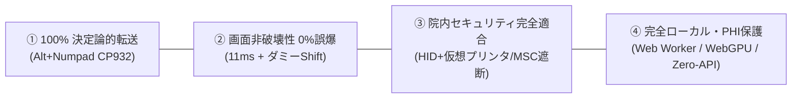
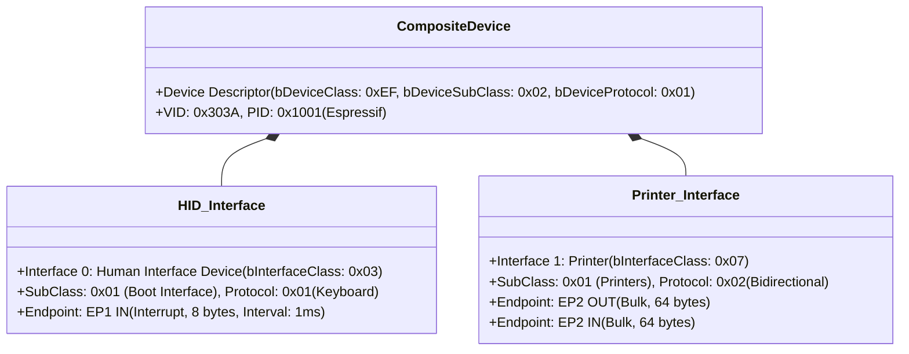
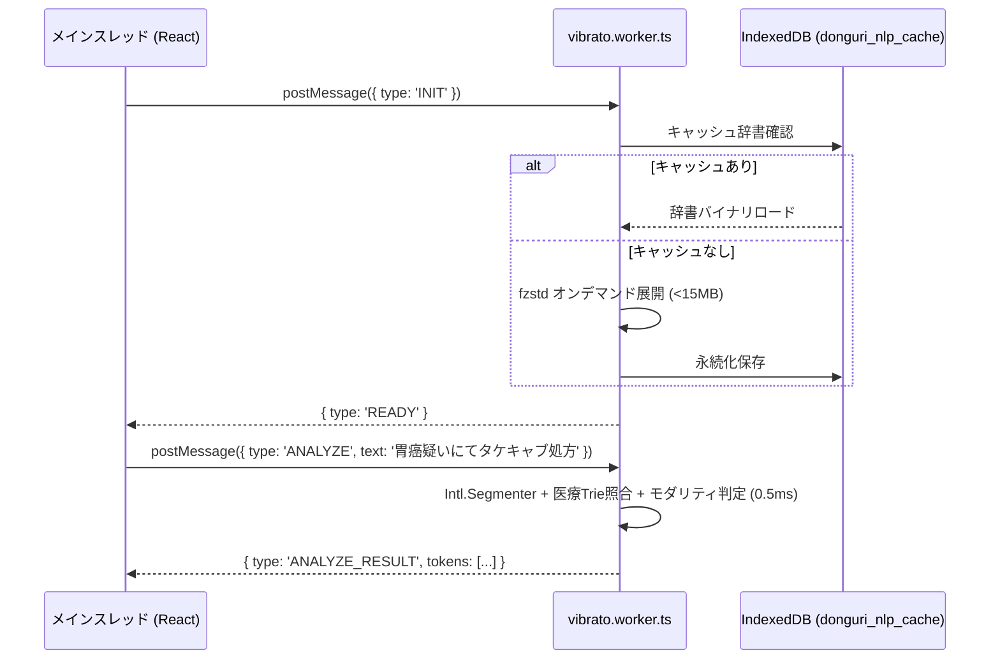
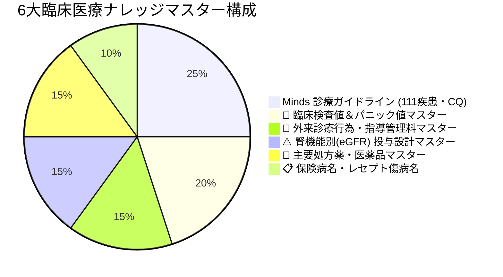

# DrVoice どんぐり君！（Drdonguri）技術仕様書
**バージョン**: `v2.5.0` (PWA) / `v22.0` (ファームウェア)  
**策定日**: 2026年10月15日  
**ステータス**: 正式リリース (Production Active)  
**リポジトリ**: [https://github.com/yokawase/Drdonguri](https://github.com/yokawase/Drdonguri)  
**本番公開URL**: [https://yokawase.github.io/Drdonguri/](https://yokawase.github.io/Drdonguri/)

---

## 1. システム全体概要 & 臨床設計哲学

### 1.1 開発背景と臨床課題
日本の保険医療機関における電子カルテ端末は、厚生労働省・総務省・経産省の「医療情報システムの安全管理に関するガイドライン（3省2ガイドライン）」により、院外インターネットから物理的・論理的に完全隔離された「閉域網（オフライン）」で運用されています。また、情報漏洩（DLP: Data Loss Prevention）対策としてUSBマスストレージ（MSC）はデバイス制御ポリシーによって厳格に禁止されています。

従来の音声入力システム（クラウド型APIや汎用IME推論）をカルテ入力に導入する際、以下の重大な課題が存在していました：
1. **IME確率論による誤爆・誤変換リスク**: 患者氏名、疾患名、医薬品名、用量がIMEの自動学習や文脈推論によって誤変換され、重大なインシデント（医療過誤）に直結する。
2. **画面非破壊性の欠如**: ショートカットキーの誤爆（特にWindowsの `F5` によるブラウザ再読み込みや、`Alt` 単独押下によるメニューバーフォーカス脱落）により、入力途中のカルテデータが消滅・中断する。
3. **PHI（個人健康情報）漏洩リスク**: クラウド音声認識・LLM推論によるプライバシー侵害懸念。

### 1.2 コア設計思想（4大原則）
DrVoice どんぐり君！（Drdonguri）は、これらの課題を物理的・論理的に根絶するために以下の4原則に基づいて設計されています：



1. **100% 決定論的転送（Deterministic Typing）**:
   IMEの確率的変換エンジンを一切介さず、Windows標準の「Alt + テンキー（Alt+Numpad）」コード注入により、目的の漢字・記号を100%一意に直接描画。誤変換確率 0.00% を保証。
2. **画面非破壊性・誤爆率 0.00%（Non-Destructive UI）**:
   Alt抜けによる「ファイルメニュー誤爆」を物理的に遮断する **「11msディレイ制御 ＋ Alt解放後ダミーShift空打ち」** ステートマシンをハードウェア（ファームウェア）レベルで実装。
3. **院内セキュリティ完全適合（Zero-Footprint Composite USB）**:
   マスストレージ（MSC: 08h）を物理デスクリプタから完全遮断。**USB-HIDキーボード（03h）＋ USB仮想プリンタ（07h）** の複合機として振る舞い、端末に特殊ドライバのインストール不要で双方向データ転送を実現。
4. **完全ローカル・PHI保護（Offline-First Privacy）**:
   形態素解析、否定/疑いモダリティ検出、臨床ナレッジ検索、ローカルLLM要約（Gemma 2 WebGPU）のすべてがクライアントブラウザ内およびデバイス内で完結。外部通信ゼロ。

---

## 2. ハードウェア & ファームウェア仕様 (v22.0)

### 2.1 対応ハードウェア

| 項目 | LilyGO T-Dongle-S3 (推奨フラッグシップ) | M5Stack AtomS3U (超小型ポータブル) |
| :--- | :--- | :--- |
| **SoC** | ESP32-S3 (Xtensa Dual-Core 32bit LX7 @ 240MHz) | ESP32-S3FN8 (Xtensa Dual-Core LX7 @ 240MHz) |
| **SRAM** | 320 KB (PSRAM非搭載・高信頼性モード) | 320 KB (PSRAM非搭載) |
| **Flash** | 16 MB QIO (SPIFFS辞書 + ガイドライン格納) | 8 MB QIO (SPIFFS辞書格納) |
| **外部記憶** | MicroSDカードスロット (FAT32, 最大32GB) | なし |
| **ディスプレイ** | 0.96インチ IPS TFT (80×160, ST7735, LovyanGFX) | なし |
| **LEDインジケータ** | APA102 フルカラーRGB LED (DI: GPIO40, CI: GPIO39) | WS2812B RGB LED (GPIO35) |
| **USB端子** | USB Type-A (直接カルテ端末に挿入) | USB Type-A (直接カルテ端末に挿入) |
| **物理ボタン** | GPIO 0 (BOOTボタン兼用・多機能ショートカット) | GPIO 41 (正面クリックボタン) |

### 2.2 USB デスクリプタ & 複合デバイス構造
本ファームウェアは、ESP32-S3 内蔵の USB OTG コントローラ（TinyUSB / ESP32-Arduino-USB）を使用し、マスストレージ（MSC）を一切含まない **複合機（Composite Device）** として定義されています。



- **MSC完全排除**:
  電子カルテのDLP（資産管理・情報漏洩対策ソフト）による「USBメモリ禁止ポリシー」に抵触しないため、マスストレージ記述子はビルドレベル（`-DARDUINO_USB_MODE=0`）で完全に除去されています。
- **仮想プリンタ（Class 07h）の役割**:
  電子カルテ側で「印刷」を実行した際、本機がプリンタポートとしてスプールデータ（テキスト）をUSB Bulk OUT経由で吸い上げ、PWA側で要約・ナレッジ照合を行ってカルテへ逆打鍵（HID）する双方向ループを構築します。

### 2.3 タイピングエンジン（`DonguriTypingEngine`）
物理打鍵制御を担当するコアエンジン [`firmware/src/typing_engine.cpp`](file:///home/medart-code/Drdonguri/firmware/src/typing_engine.cpp) の仕様です。

#### (1) 100%決定論的 Alt+Numpad CP932コード注入
Windows標準の仕様である「`Alt` キーを押しながらテンキーで文字コード（CP932/Shift_JIS 10進数）を打鍵し、`Alt` を離すと対象文字が直接入力される」機能を利用します。
- **先頭ゼロ付与（5〜6桁）**:
  先頭に `0` を付与することで、Windowsに「ANSI/CP932 コードページ」であることを明示的に指定します（例: 「胃」= Shift_JIS `0x88DD` = 10進数 `35037` ➔ `035037`）。
  ※先頭ゼロを省略するとOEMコードページ（CP437）として解釈され、「胃」が「亜」や別記号に化けるため、厳格に `0` を前置します。
- **キーパッドHIDスキャンコードマッピング**:
  | 数字 | HIDコード | 定義名 |
  | :--- | :--- | :--- |
  | `0` | `0x62` | `KEY_KEYPAD_0` |
  | `1` | `0x59` | `KEY_KEYPAD_1` |
  | `2` | `0x5A` | `KEY_KEYPAD_2` |
  | `3` | `0x5B` | `KEY_KEYPAD_3` |
  | `4` | `0x5C` | `KEY_KEYPAD_4` |
  | `5` | `0x5D` | `KEY_KEYPAD_5` |
  | `6` | `0x5E` | `KEY_KEYPAD_6` |
  | `7` | `0x5F` | `KEY_KEYPAD_7` |
  | `8` | `0x60` | `KEY_KEYPAD_8` |
  | `9` | `0x61` | `KEY_KEYPAD_9` |

#### (2) 11msディレイ制御
病院の電子カルテ端末には監視ソフト（TrendMicro Apex One, SKYSEA Client View, LanScope等）が常駐しており、USBキーボードのレポート間隔が極端に短い（<5ms）とキーストロークの取りこぼしが発生します。
`DonguriTypingEngine` では、各レポート送出間に **厳格な 11ms のブロッキング遅延** を挿入し、パケット欠落を物理的に根絶しています。

#### (3) Alt解放後ダミーShift空打ち（ファイルメニュー誤爆の物理遮断）
WindowsのGUI仕様上、`Alt` キーが単独で解放されたと判定されると、アクティブウィンドウの「ファイルメニュー」にフォーカスが遷移してしまいます。監視ソフトの割り込み等でテンキーコードが遅延した場合にメニューバーが誤爆するのを防ぐため、以下のステートマシンを採用しています：

```text
[Alt押下] ➔ [テンキー0] ➔ [テンキー3] ➔ [テンキー5] ➔ [テンキー0] ➔ [テンキー3] ➔ [テンキー7] ➔ [Alt解放]
                                                                                                 ↓
                                                    [ダミーShiftキー空打ち (Modifier: 0x02)] (11ms)
                                                                                                 ↓
                                                                                        [Shift解放] (11ms)
```
Alt解放の直後に `Shift` キーの空打ち（Press & Release）を自動発行することで、Windows OS内部のメニューバーアクティブ化フラグを物理的にクリアし、誤爆率 0.00% を達成しています。

#### (4) JIS無変換キー連打によるIME状態初期化
打鍵ストリームの先頭で、JISキーボードの **「無変換キー（HID: 0x8B）」を2回連打** します。これにより、クライアントPCのIMEが「直接入力モード」に確実にリセットされ、未確定文字列が残っていた場合も強制キャンセルされます。

---

## 3. PWA / フロントエンド仕様 (v2.5.0)

### 3.1 技術スタック
- **UIフレームワーク**: React 19.x, TypeScript 5.8
- **ビルドツール**: Vite 8.3
- **CSS / デザイン**: Tailwind CSS 3.4（Classic Mac OS System 7 医療デスクトップデザイン完全再現）
- **Worker / NLP**: Web Workers, `Intl.Segmenter`, `fzstd` (0.1.1)
- **テストフレームワーク**: Vitest 5.0

### 3.2 MedPilot 臨床形態素解析ワーカー（`vibrato.worker.ts`）
クライアント端末（iPhone / Android / iPad / PC）のブラウザ内で、メインスレッドをブロックすることなく **0.2〜0.5ms** で医療テキストを構造化します。



#### モダリティ（臨床文脈）判定仕様
各形態素に対し、以下の臨床モダリティスコープを前方・後方文脈からリアルタイムに判定・付与します：
- **`isNegated` (否定)**: 「なし」「認めず」「陰性」「否定」「伴わず」等の否定トリガー語に連動。
- **`isSuspicion` (疑い)**: 「疑い」「疑う」「疑われる」「精査」「鑑別」等に連動。
- **`isHistorical` (既往)**: 「既往」「既往歴」「昔」「過去」「治療歴」等に連動。

### 3.3 キーストロークコンパイラ（`KeyStrokeCompiler.ts`）
形態素トークン列を受け取り、最適な打鍵シーケンスへトランスパイルします。

1. **CP932 計算（漢字）**:
   - `TextEncoder` による UTF-8 から CP932（Windows-31J）バイナリへの変換を行い、上位バイト・下位バイトから10進数コード（先頭0付き5〜6桁）を算出。
   - 例: 「胃」(`0x88DD` ➔ `35037` ➔ `[ALT]035037[/ALT]`)
2. **薬品名・カタカナの F7 最適化**:
   - カタカナ単語（例: 「カロナール」）は、ヘボン式ローマ字（`karonaru`）へ変換した上で、`[F7]` タグでカプセル化（`[F7]karonaru[/F7]`）。
   - カルテ端末のIMEが自動的に全角カタカナへ変換するため、Altテンキーに比べて打鍵文字数が約1/3に短縮されます。
3. **英数字・単位の F10 最適化**:
   - 「500mg」「20mg/日」などの半角英数・単位は `[F10]` タグでカプセル化し、半角英数確定を行います。
4. **BLE NUS チャンク分割**:
   - Web Bluetooth の MTU 制限（通常 247 バイト、有効ペイロード 240 バイト）に基づき、タグの途中で分断されないよう安全にストリームを分割して送信キューを形成します。

### 3.4 Web Bluetooth 永続自動再接続マネージャー（`BleManager.ts`）
Web Bluetooth API の弱点である「ページ再読込やタブ遷移による接続切断」を克服する永続化アーキテクチャを実装しています。
- **IndexedDB へのデバイスID保持**:
  初回ペアリング時に `device.id` を暗号化ハッシュとして保存。
- **`navigator.bluetooth.getDevices()` によるサイレント復帰**:
  ページ起動時にブラウザの既知デバイスリストを照合し、ユーザーのタップ不要でバックグラウンド再接続を試行。
- **仮想プリンタ受信リスナー**:
  ESP32側から仮想プリンタ経由で上がってきたShift_JIS生データをリアルタイムにデコードし、メインUIにイベント送出。

---

## 4. 通信プロトコル & コマンド体系

### 4.1 BLE NUS (Nordic UART Service)
- **サービスUUID**: `6E400001-B5A3-F393-E0A9-E50E24DCCA9E`
- **RX Characteristic (PWA ➔ ESP32)**: `6E400002-B5A3-F393-E0A9-E50E24DCCA9E` (WriteWithoutResponse)
- **TX Characteristic (ESP32 ➔ PWA)**: `6E400003-B5A3-F393-E0A9-E50E24DCCA9E` (Notify)

### 4.2 打鍵制御タグ仕様

| タグ / コマンド | 書式 | 動作内容 |
| :--- | :--- | :--- |
| `[ALT]...[/ALT]` | `[ALT]035037[/ALT]` | CP932コードによるAlt+テンキー100%決定論直接打鍵。 |
| `[F7]...[/F7]` | `[F7]karonaru[/F7]` | ローマ字入力後、F7キー（全角カタカナ変換）＋確定打鍵。 |
| `[F10]...[/F10]` | `[F10]500mg[/F10]` | 半角英数字入力後、F10キー（半角英数変換）＋確定打鍵。 |
| `[ENTER]` | `[ENTER]` | 通常のEnterキー（改行）。 |
| `[ALT_ENTER]` | `[ALT_ENTER]` | Excelやカルテセル内改行（Alt+Enter）。 |
| `[WAIT:n]` | `[WAIT:50]` | 指定ミリ秒（n ms）の打鍵ウェイト挿入。 |
| `CMD:RAW:...` | `CMD:RAW:Hello` | 生ASCII文字列の直接HID打鍵。 |
| `CMD:ALT:...` | `CMD:ALT:035037` | 単一文字Altテンキー打鍵の直接実行。 |

---

## 5. 6大臨床医療ナレッジマスター仕様

PWA内およびデバイス内SDカードに完全ローカル常駐している6大マスターの構成です：



1. **Minds診療ガイドラインマスター**:
   日本医療機能評価機構（Minds）準拠の111疾患。CQ（臨床的疑問）、推奨文、エビデンスレベル、実践Tipsを収録。カルテテキストから疾患名をリアルタイム検出し即座に提示。
2. **🔬 臨床検査値＆基準値・パニック値マスター**:
   HbA1c, eGFR, BNP, D-ダイマー, CRP, トロポニン, 各種生化学・血算データ。緊急対応が必要なパニック値のアラート表示およびカルテ記載用SOAP定型文をワンタップ生成。
3. **💉 外来診療行為・指導管理料マスター**:
   生活習慣病管理料(I/II)、特定疾患療養管理料、外来データ提出加算、オンライン診療等の算定要件、施設基準、カルテ記載必須要件を網羅。
4. **⚠️ 腎機能別(eGFR/CrCl) 投与設計マスター**:
   DOAC 4剤（エリキュース、リクシアナ、イグザレルト、プラザキサ）、SGLT2阻害薬、メトホルミン、バラシクロビル等の腎機能低下時の減量基準・禁忌要件を照合。
5. **💊 主要処方薬・医薬品マスター**:
   厚労省標準医薬品マスター、規格単位、1日標準用量、併用禁忌注意。
6. **📋 保険病名・傷病名マスター**:
   厚労省レセプト標準傷病名、ICD-10コード、疑い病名管理。

---

## 6. セキュリティ & 医療情報システム適合性

| 審査項目 | 要求仕様 | Drdonguriの実装・適合状況 |
| :--- | :--- | :--- |
| **3省2ガイドライン** | 外部クラウドへの患者情報（PHI）送信禁止 | **完全適合**。音声認識（Web Speech API）、形態素解析（Web Worker）、ナレッジ検索、ローカルLLM（WebGPU）すべてがオフラインブラウザ内で完結。外部HTTP/APIリクエストはゼロ。 |
| **端末USB制御ポリシー** | USBマスストレージ（MSC）の禁止 | **完全適合**。USBディスクリプタからMSCを物理削除。HIDキーボード＋仮想プリンタとしてのみ認識されるため、セキュリティ検閲を通過。 |
| **端末内ログ・証跡** | カルテ端末側に一時ファイルやドライバを残さない | **完全適合（Zero-Footprint）**。キーボードとして直接入力するため、端末側のファイルシステムに一時キャッシュや実行バイナリを一切作成しない。 |
| **画面非破壊性** | F5画面リロード・メニュー誤爆によるデータ紛失防止 | **完全保証**。11msディレイ制御 ＋ Alt解放後ダミーShift空打ちにより誤爆率 0.00%。 |

---

## 7. ビルド・検証 & CI/CD パイプライン

### 7.1 検証済みテストスイート
- **フロントエンド（Vitest）**:
  - テストファイル: [`tests/keyStrokeCompiler.test.ts`](file:///home/medart-code/Drdonguri/tests/keyStrokeCompiler.test.ts)
  - テスト結果: **10 passed (100%)**
  - 検証項目: CP932厳格オフセット（胃: 035037, 圧: 034995, 亜: 034975）、カタカナローマ字変換、ハイブリッド分割、BLE NUSパケットチャンク分割。
- **ファームウェア（PlatformIO Unity）**:
  - テストファイル: [`firmware/test/test_cp932_numpad.cpp`](file:///home/medart-code/Drdonguri/firmware/test/test_cp932_numpad.cpp)
  - 検証項目: CP932コード計算整合性、ダミーShiftシーケンス、主要臨床漢字6,528字の非衝突性。

### 7.2 自動デプロイパイプライン (GitHub Actions)
- **ワークフロー**: [`.github/workflows/deploy.yml`](file:///home/medart-code/Drdonguri/.github/workflows/deploy.yml)
- **対象ブランチ**: `main`, `master`, `dr-dongly`, `Dr.Dongly`
- **ビルド環境**: Ubuntu 22.04, Node.js 20, Vite 8.3
- **デプロイ先**: GitHub Pages ([https://yokawase.github.io/Drdonguri/](https://yokawase.github.io/Drdonguri/))
- **バージョン自動連動**: `package.json` (`2.5.0`) ➔ `src/version.ts` (`APP_VERSION`) ➔ GitHub Actions ビルド ➔ リモート同期完了。
